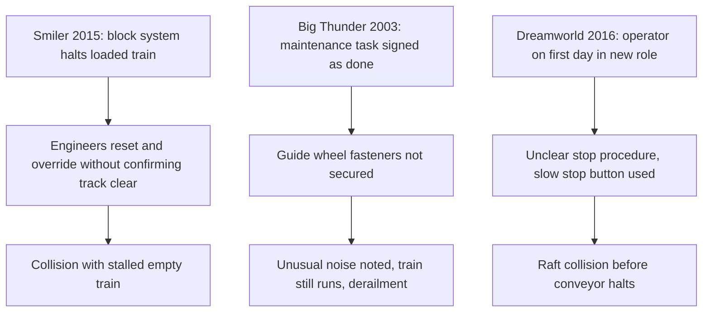

These are stories about systems that made the wrong action easy. The Smiler at Alton Towers on 2 June 2015 is the clearest example. An empty test train stalled on the track; the block system held the loaded train behind it. Engineers overrode the system without an adequate procedure for confirming the course was clear, and the loaded train was released into the stalled one. The HSE's focus was the operator's failure to give engineers a safe system of work.

Big Thunder Mountain Railroad in 2003 is the maintenance version. Fasteners on a guide wheel were not properly secured, the work had been signed off, and staff who heard an unusual noise did not have a rule that kept the train out of service until it was found.

At Dreamworld in 2016 the coroner recorded that the operator at the unload controls was on her first day trained in that role, and that the ride's stop procedures and controls were unclear. The common lesson is that [operator training](../safety-standards/operator-training.md), [ride operations staffing](../operations-business/ride-operations-staffing.md) levels and the [ride control system](../safety-standards/ride-control-systems.md)'s override design are one problem. [Decision fatigue](../human-factors/decision-fatigue.md) and a [service culture](../operations-business/service-culture.md) that prizes uptime over stopping widen the holes.

## Explore further
- `towersstreet-smiler-fine-2016` — TowersStreet: Merlin fined £5 million for Smiler incident
- `wikipedia-the-smiler` — Wikipedia: The Smiler (June 2015 incident)
- `tpi-big-thunder-2003` — Theme Park Insider: Disney takes blame for Thunder Mountain death
- `qld-coroner-dreamworld-2020` — Coroners Court of Queensland: Findings of the Dreamworld inquest
