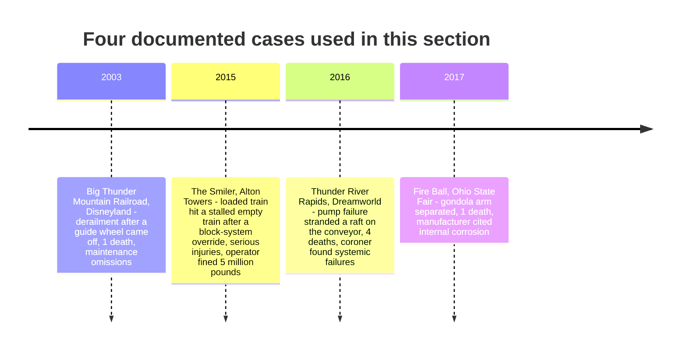

This knowledge base uses four, chosen because an official body published findings and because together they cover the main failure types. On 5 September 2003 a Big Thunder Mountain Railroad train at Disneyland partially derailed after an upstop guide wheel came off after maintenance omissions; one guest died. On 2 June 2015 a loaded train on The Smiler at Alton Towers struck an empty train that had stalled; engineers had overridden the block system, and the operator was later fined five million pounds. On 25 October 2016 a pump failure on Dreamworld's Thunder River Rapids ride dropped the water level, a raft stranded on the conveyor, the following raft collided with it and four people died. On 26 July 2017 a gondola arm on the Fire Ball ride at the Ohio State Fair separated in motion, killing one rider; the manufacturer attributed it to excessive internal corrosion.

Each case appears again under [human factors](../safety-standards/human-factors-incidents.md), [mechanical failure](../safety-standards/mechanical-failure-cases.md) or [design oversight](../safety-standards/design-oversight-cases.md), and each changed regulation, which is why they sit beside the [regulatory landscape](../safety-standards/regulatory-landscape.md). They also loom far larger in [risk perception](../human-factors/risk-perception-and-trust.md) than the statistics would suggest, part of the [safe-danger paradox](../human-factors/safe-danger-paradox.md) of thrill rides.

## Explore further
- `tpi-big-thunder-2003` — Theme Park Insider: Disney takes blame for Thunder Mountain death
- `towersstreet-smiler-fine-2016` — TowersStreet: Merlin fined £5 million for Smiler incident
- `qld-coroner-dreamworld-2020` — Coroners Court of Queensland: Findings of the Dreamworld inquest
- `wosu-fire-ball-corrosion-2017` — WOSU: Fire Ball manufacturer blames Ohio State Fair accident on excessive corrosion
