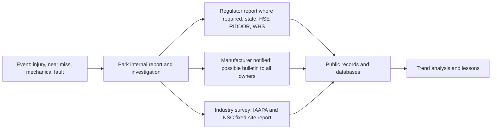

Incident reporting starts inside the park: operators log every injury, near miss and unexplained fault, and maintenance investigates. From there the path splits. Regulators often require a report; in Great Britain RIDDOR sets out which injuries and dangerous occurrences must be reported to the HSE, and US states each set their own thresholds. The manufacturer should hear about anything mechanical, because a fault on one ride may apply to every unit sold, and the result is a service bulletin to all owners.

The pooled picture is honest but incomplete. IAAPA's North America Fixed-Site Amusement Ride Safety Report, built on an annual survey conducted by the National Safety Council, offers aggregate injury statistics for participating parks. Saferparks gathered state and federal accident records through public-records requests between 2000 and 2017 and warns that the data cannot be used to compare states, parks or years, because reporting rules vary so much, a direct consequence of the [regulatory landscape](../safety-standards/regulatory-landscape.md).

Data is also the raw material of [safety culture](../safety-standards/safety-culture.md): a park that rewards near-miss reports learns faster. It feeds [guest research](../operations-business/guest-research.md), underpins [vision-based safety monitoring](../ai-future/vision-safety-monitoring.md), and quietly contrasts with guests' [risk perception](../human-factors/risk-perception-and-trust.md), which tracks headlines rather than rates.

## Explore further
- `ridesdatabase-saferparks-data` — RidesDatabase: Saferparks accident data from state and federal regulators
- `iaapa-ride-safety-report-2023` — IAAPA: 2023 North America Fixed-Site Amusement Ride Safety Report
- `hse-riddor` — HSE: RIDDOR, Reporting of Injuries, Diseases and Dangerous Occurrences Regulations
- `ridesdatabase-bulletins` — RidesDatabase: Amusement ride safety bulletins
