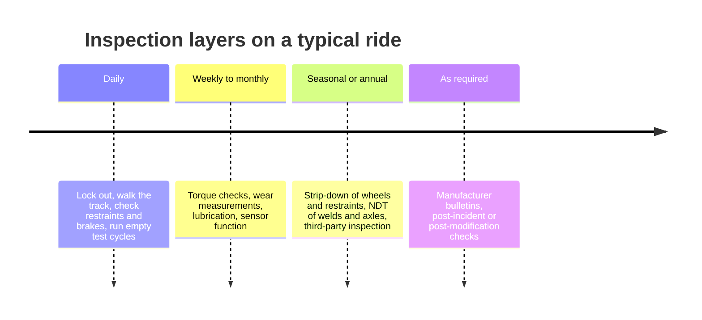

Inspection is how a park finds trouble before trouble finds a guest. The first layer is daily. Before opening, maintenance staff lock the ride out, walk the track and structure looking for anything loose, cracked or leaking, check every restraint and brake, and run empty trains through the course listening for the wrong sound. Only then do operators take over. Weekly and monthly checks add torque, wear and lubrication tasks from the manufacturer's manual, and once a season major assemblies such as [wheels and bogies](../ride-engineering/wheels-and-bogies.md) and restraints are stripped and examined.

Non-destructive testing, NDT, is the deep layer. Methods such as magnetic particle and dye penetrant find surface cracks in welds; ultrasonic testing sees inside axles and pins. Trained NDT technicians look specifically for [fatigue](../ride-engineering/fatigue.md) cracking and hidden [corrosion](../ride-engineering/corrosion-and-weathering.md).

The 2017 Fire Ball failure at the Ohio State Fair is the lesson. The manufacturer attributed the breakup to excessive corrosion inside a gondola support beam that had thinned the wall over years, somewhere routine visual inspection could not see. It sits among the [mechanical failure cases](../safety-standards/mechanical-failure-cases.md) and is why manufacturers now specify internal NDT intervals. Good inspection also pays back in [downtime and availability](../operations-business/downtime-and-availability.md).

## Explore further
- `coaster101-inspection-101` — Coaster101: Roller Coaster Inspection 101
- `asnt-what-is-ndt` — ASNT: What is nondestructive testing?
- `hse-hsg175` — HSE HSG175: Fairgrounds and amusement parks, guidance on safe practice
- `wosu-fire-ball-corrosion-2017` — WOSU: Fire Ball manufacturer blames Ohio State Fair accident on excessive corrosion
