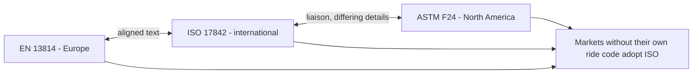

Rides are a global product, designed in one country and run in another. ISO 17842, Safety of amusement rides and amusement devices, exists so that one design file can satisfy many regulators. It is written by ISO Technical Committee 254 and was first published in 2015; the second edition of Part 1 (design and manufacture) appeared in September 2023, with Parts 2 and 3 covering operation and inspection, the same split as [EN 13814](../safety-standards/en-13814.md).

The scope is the same too: mobile, temporary or permanent machinery and structures built for leisure, excluding grandstands, waterslides and playgrounds. Where a country has no ride code of its own, ISO 17842 is the obvious thing to write into law, which is why it matters so much for the [Asian expansion](../history/asian-expansion.md) of the industry and for [coaster manufacturers](../history/coaster-manufacturers.md) selling into new markets.

It is not identical to [ASTM F24](../safety-standards/astm-f24.md). Acceleration limits, restraint classes and documentation differ in detail, and the committees liaise rather than merge. That is one reason the [regulatory landscape](../safety-standards/regulatory-landscape.md) still looks like a patchwork, and why [testing and commissioning](../design-process/testing-and-commissioning.md) plans name the exact standard and edition.

## Explore further
- `iso-17842-1-2023` — ISO 17842-1:2023 Safety of amusement rides and devices, Part 1
- `genorma-en-13814-1` — EN 13814-1:2019+A1:2024 Safety of amusement rides, Part 1
- `iaapa-safety-page` — IAAPA: Safety and security, with an overview of ASTM, CEN and ISO standards
