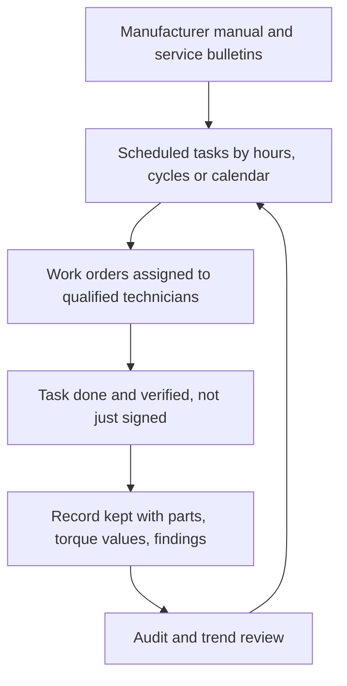

A maintenance programme is a written promise that every task the manufacturer calls for will be done on time by someone competent and recorded so a stranger could check. ASTM F770 and the ADIPS lifecycle both expect it: scheduled intervals in hours, cycles or calendar time; work orders; parts traceability; and a running file of bulletins from the manufacturer that may change the schedule overnight.

Two cases show how the paper and the work can drift apart. After the 2003 Big Thunder Mountain Railroad derailment at Disneyland, which killed one guest, Disney acknowledged that required maintenance tasks had not been performed correctly; a guide wheel's fasteners were not properly secured, and work had been signed off as complete. The Queensland coroner described Dreamworld's record-keeping as informal and ad hoc, with departments working in silos. Both are discussed as [human-factors incidents](../safety-standards/human-factors-incidents.md).

The fix is cultural as much as technical. Verify the task, not the signature, and treat an operator's report of an unusual noise as a maintenance input. Done well, the programme is the backbone of [preventive maintenance](../operations-business/preventive-maintenance.md), it drives [spare parts and obsolescence](../operations-business/spare-parts-and-obsolescence.md) planning, sets the real [ride lifecycle](../operations-business/ride-lifecycle.md), and provides the data that [predictive maintenance](../ai-future/predictive-maintenance.md) models need.

## Explore further
- `astm-f770-operations` — ASTM F770 Ownership, Operation, Maintenance, and Inspection of Amusement Rides
- `tpi-big-thunder-2003` — Theme Park Insider: Disney takes blame for Thunder Mountain death
- `qld-coroner-dreamworld-2020` — Coroners Court of Queensland: Findings of the Dreamworld inquest
- `adips-system-for-safety` — ADIPS: The system for safety of amusement devices
