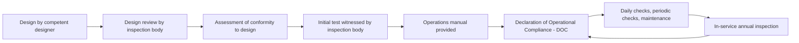

A standard says what good looks like; an inspection scheme makes someone sign for it. The clearest example is the UK's Amusement Device Inspection Procedures Scheme, ADIPS, run by the industry and recognised in the HSE's guidance book HSG175. Before a ride is used, a registered inspection body reviews the design, confirms the ride was built to it, witnesses an initial test and checks the operations manual. Only then is a Declaration of Operational Compliance issued. Every year after that, an in-service inspection renews it, and the public can look up a ride's DOC online.

Germany's model is older. Certification bodies such as TÜV SÜD, founded as a pressure-vessel inspection association in 1866, have been examining rides at the Oktoberfest since 1929, and state authorities rely on their reports to approve both travelling and permanent rides. In the United States the pattern is state inspectors plus individual inspectors certified by bodies like AIMS International or NAARSO.

The common thread is a loop: certify, operate, re-inspect. That loop underpins the practical [inspections](../safety-standards/inspections.md) a park performs, defines when [testing and commissioning](../design-process/testing-and-commissioning.md) is "done", and quietly shapes the whole [ride lifecycle](../operations-business/ride-lifecycle.md) for [European parks](../history/european-parks.md).

## Explore further
- `adips-system-for-safety` — ADIPS: The system for safety of amusement devices
- `hse-hsg175` — HSE HSG175: Fairgrounds and amusement parks, guidance on safe practice
- `tuv-sud-kasper-2011-ride-certification` — TÜV SÜD: Ride certification scheme and operation authorization (talk)
- `aims-certifications` — AIMS International certification programs
