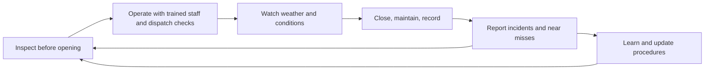

A ride leaves the factory safe on paper. Whether it stays safe for thirty seasons depends on the people who run it. Operations safety is the set of routines that standards such as ASTM F770 and the UK's HSG175 expect of an owner: the ride is [inspected](../safety-standards/inspections.md) every morning before guests arrive, kept to a written [maintenance programme](../safety-standards/maintenance-programs.md), run by staff with documented [operator training](../safety-standards/operator-training.md), dispatched only when a fixed [dispatch procedure](../safety-standards/dispatch-procedures.md) is complete, shut down by clear [weather policies](../safety-standards/weather-policies.md), and followed by honest [incident reporting](../safety-standards/incident-reporting.md).

None of this is glamorous, and that is the point. The ADIPS lifecycle model for UK rides puts "ongoing device integrity" on equal footing with design: daily checks, periodic checks, maintenance and annual inspection by competent people. The same loop feeds the business, because well-run rides have better [downtime and availability](../operations-business/downtime-and-availability.md) and lower surprise costs. It also feeds guests' [risk perception and trust](../human-factors/risk-perception-and-trust.md): visible checks, calm operators and clean procedures are part of why people queue for a machine that drops them from forty metres. [Ride operations staffing](../operations-business/ride-operations-staffing.md) and [opening and closing procedures](../operations-business/opening-and-closing-procedures.md) are where the operations land picks this up.

## Explore further
- `astm-f770-operations` — ASTM F770 Ownership, Operation, Maintenance, and Inspection of Amusement Rides
- `hse-hsg175` — HSE HSG175: Fairgrounds and amusement parks, guidance on safe practice
- `adips-system-for-safety` — ADIPS: The system for safety of amusement devices
