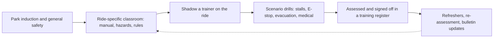

Standards such as ASTM F770 and schemes like ADIPS use the same word for what they must be: competent, meaning trained and assessed for the specific ride, in normal operation and in emergencies, and recorded as such. Training usually runs from a general park induction to ride-specific classroom work on the manual and rules, time shadowing a trainer, then drills for the things that rarely happen: a stalled train, an emergency stop, an evacuation from height. Sign-off goes in a register, and refreshers follow each season or each bulletin.

Industry bodies add portable credentials. AIMS International runs certifications for ride operations technicians, maintenance technicians and inspectors; NAARSO certifies inspectors. Larger parks layer on service and [cast role-play](../story-experience/cast-role-play.md) training so that safety and [service culture](../operations-business/service-culture.md) are taught as one job.

The Dreamworld inquest documented an operator on her first day in a new position at the ride's controls when the 2016 tragedy happened, and found training records that were hard to reconstruct. It is a reminder that [ride operations staffing](../operations-business/ride-operations-staffing.md) is a safety decision, discussed further under [human-factors incidents](../safety-standards/human-factors-incidents.md). Well-trained operators also drive [rider compliance](../human-factors/rider-compliance.md): clear, confident instructions get followed.

## Explore further
- `astm-f770-operations` — ASTM F770 Ownership, Operation, Maintenance, and Inspection of Amusement Rides
- `aims-certifications` — AIMS International certification programs
- `qld-coroner-dreamworld-2020` — Coroners Court of Queensland: Findings of the Dreamworld inquest
