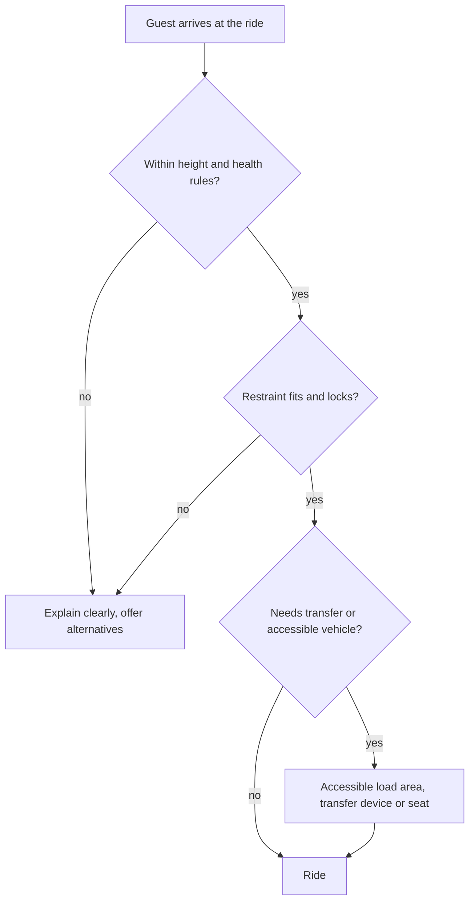

A ride is designed for a population, not a person. Patron accommodation is the part of design safety that asks who can safely use the seat, restraint and load platform, and then makes that range as wide as the physics allows. Design standards require the manufacturer to state the rider limits, minimum and maximum height, sometimes weight or hip breadth, and any health exclusions, and the operator must enforce them. Those limits flow from the restraint class, which is why this card pairs with [restraint design rules](../safety-standards/restraint-design-rules.md).

In the United States the 2010 ADA Standards for Accessible Design add a legal floor for permanent parks. Their amusement ride sections require accessible routes to load and unload areas, and for most rides either a wheelchair space, a transfer seat or a transfer device, with turning space and level landings.

For designers the tension is real: a wider seat helps [seat width and hip breadth](../human-factors/seat-width-and-hip-breadth.md) but may loosen the fit for small riders; a transfer device adds load time. Good answers come from [accessibility](../human-factors/accessibility.md) thinking early, [accessible vehicles](../human-factors/accessible-vehicles.md) planned into the train, clear [height and health requirements](../human-factors/height-and-health-requirements.md), and [disability access services](../human-factors/disability-access-services.md) that match the hardware.

## Explore further
- `ada-2010-standards` — 2010 ADA Standards for Accessible Design (amusement ride sections 234 and 1002)
- `astm-f2291-design` — ASTM F2291 Standard Practice for Design of Amusement Rides and Devices
- `hse-hsg175` — HSE HSG175: Fairgrounds and amusement parks, guidance on safe practice
