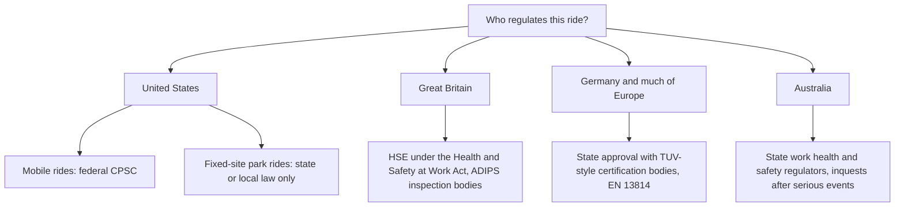

There is no single ride regulator on earth. In the United States the Consumer Product Safety Commission can investigate accidents and push manufacturers to fix defects, but only for mobile rides at fairs and carnivals. Permanent rides in amusement and water parks are exempt from federal oversight, so each state or city decides whether and how to inspect them, what must be reported, and who investigates. Some states run strong programmes; a few have almost none. Saferparks called this a "patchwork", and it shapes [industry structure](../operations-business/industry-structure.md) and even [site selection](../masterplanning/site-selection.md).

Great Britain works differently. The Health and Safety at Work Act 1974 places duties on designers, manufacturers, organisers, controllers and attendants, enforced by the HSE, with the industry-run ADIPS scheme supplying registered inspection bodies. Germany pairs state approval with certification bodies such as TÜV working to EN 13814. Australia leaves rides to state work health and safety regulators; the Queensland coroner's 2020 Dreamworld findings led to tougher inspection rules there.

Standards are shared; enforcement is local. That gap is why [incident reporting](../safety-standards/incident-reporting.md) data is patchy, and why [professional bodies](../careers/professional-bodies.md) rather than governments often set the practical bar.

## Explore further
- `ridesdatabase-saferparks-regulations` — Saferparks: Safety regulations for U.S. amusement rides
- `hse-fairgrounds-guidance` — HSE: Fairgrounds and fairground rides guidance index
- `adips-and-the-law` — ADIPS: ADIPS and the law
- `qld-coroner-dreamworld-2020` — Coroners Court of Queensland: Findings of the Dreamworld inquest
