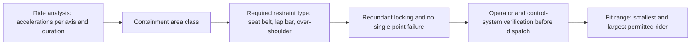

Both ASTM F2291 and EN 13814 start from the ride analysis: the sustained and peak accelerations each seat sees in every direction, and for how long. Those values place the seat in a containment class, and the class dictates what the restraint must do. Gentle, mostly positive forces may need only a seat belt or a simple bar; sustained negative g or strong lateral loads call for a restraint that holds the body in place, and inversions call for more again. Exact thresholds are edition-specific and not reproduced here.

Beyond the type, the rules cover how the restraint holds. Locking must be redundant, so that one failed ratchet, cylinder or latch still leaves the rider contained. The lock must be verifiable, by the operator's check and by sensors before dispatch. Fit limits define the smallest and largest riders the device holds properly, which is where [restraint fit](../human-factors/restraint-fit.md) and height rules come from.

The [restraint mechanisms](../ride-engineering/restraint-mechanisms.md) and [restraint locking](../ride-engineering/restraint-locking.md) cards cover the hardware; this card is the why. Designers who want more [airtime](../ride-engineering/airtime-and-negative-g.md) must accept the restraint class that comes with it, and that class sets the [lowest common denominator](../human-factors/lowest-common-denominator.md) of who can ride.

## Explore further
- `astm-f2291-design` — ASTM F2291 Standard Practice for Design of Amusement Rides and Devices
- `genorma-en-13814-1` — EN 13814-1:2019+A1:2024 Safety of amusement rides, Part 1
- `tuv-sud-kasper-2011-ride-certification` — TÜV SÜD: Ride certification scheme and operation authorization (talk)
