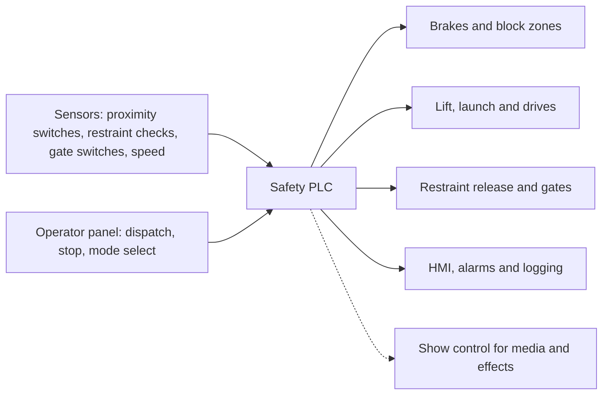

Every modern ride is run by a programmable logic controller, a rugged industrial computer that scans its inputs many times a second. A safety PLC adds hardware and firmware rated for safety-critical use: redundant processors that cross-check each other, monitored inputs and outputs, and a restricted instruction set, so that a fault inside the controller itself drives the ride to a safe state.

The most important rule is the [block system](../ride-engineering/block-system.md): two trains may never be in the same section of track, and each block must have a brake or stopping point at its end. The controller only releases a train into a block it has seen cleared by its [sensors and switches](../ride-engineering/sensors-and-switches.md). Dispatch permissives work the same way: restraints locked, gates closed, zone clear, two operators consenting.

The Smiler collision at Alton Towers in 2015 shows what the logic is protecting. The block system correctly held a loaded train because an empty train had stalled ahead; engineers manually overrode it without a safe procedure for doing so. Control systems also hand timing to [show control](../show-technology/show-control-systems.md) for [ride-show synchronisation](../show-technology/ride-show-synchronization.md), and their cycle logic sets the floor on [dispatch interval](../operations-business/dispatch-interval.md).

## Explore further
- `coaster101-brakes-blocks-sensors` — Coaster101: Brakes, blocks and sensors
- `wikipedia-plc-safety-plcs` — Wikipedia: Programmable logic controller (Safety PLCs section)
- `towersstreet-smiler-fine-2016` — TowersStreet: Merlin fined £5 million for Smiler incident
