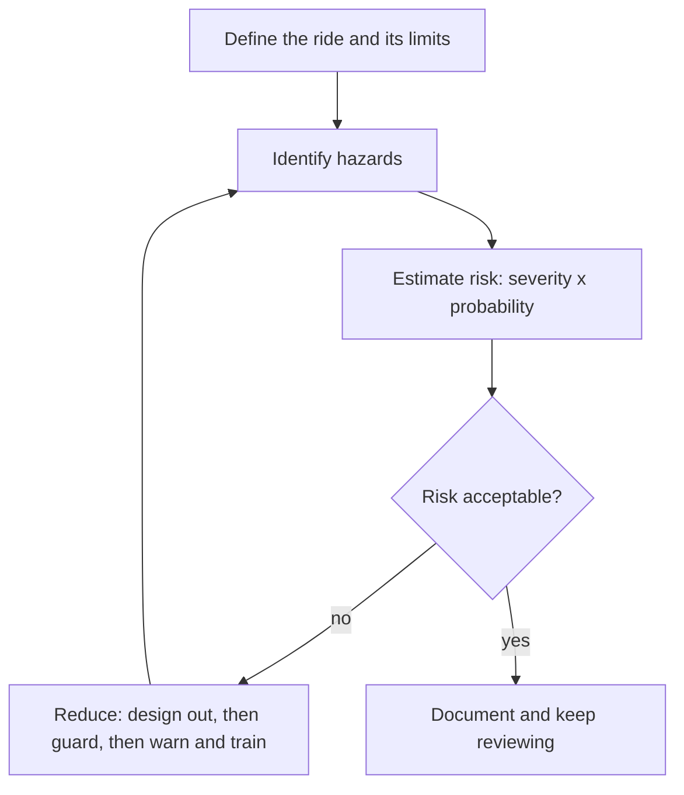

> **Formula** $RPN = S \times O \times D$
> where
> - $RPN$ is the risk priority number used in a failure mode and effects analysis to rank what to fix first
> - $S$ is severity of the effect if the failure happens
> - $O$ is how often the failure is expected to occur
> - $D$ is how hard the failure is to detect before it causes harm

Risk assessment is a loop, not a form. ISO 12100, the general machinery standard that ride standards lean on, lays it out: define the machine and how it will be used, identify every hazard, estimate each risk from how bad and how likely, decide whether it is acceptable, and if not reduce it. Reduction has a strict order: first design the hazard out, then guard against it, and only then rely on warnings, procedures and training. Then go round again.

Failure Mode and Effects Analysis, FMEA, is the bottom-up partner. Engineers list each component, ask how it could fail, what the effect would be, and score severity, occurrence and detection. A restraint latch that fails silently scores far worse than one whose failure stops the dispatch.

The Queensland coroner found that Dreamworld's Thunder River Rapids ride had never had a documented engineering risk assessment, despite decades of modifications and earlier incidents. That is the cautionary tale behind the [design oversight cases](../safety-standards/design-oversight-cases.md). Done well, the same analysis feeds [design review gates](../design-process/design-reviews-and-gates.md), early [feasibility and costing](../design-process/feasibility-and-early-costing.md), [figure reliability](../show-technology/figure-reliability.md) planning and even [predictive maintenance](../ai-future/predictive-maintenance.md) models.

## Explore further
- `iso-12100-risk-assessment` — ISO 12100:2010 Safety of machinery, risk assessment and risk reduction
- `qld-coroner-dreamworld-2020` — Coroners Court of Queensland: Findings of the Dreamworld inquest
- `hse-hsg175` — HSE HSG175: Fairgrounds and amusement parks, guidance on safe practice
