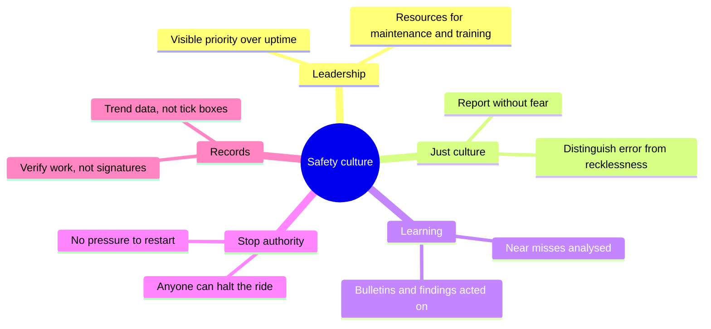

Safety culture is what an organisation does about risk when nobody is watching. The UK HSE describes it as the shared values and behaviours that shape how safety is managed, and warns that a poor culture shows up as blame, silence and workarounds. James Reason's work added the idea of a just culture: people must be able to report errors and near misses without punishment, while reckless behaviour is still dealt with.

These cases are culture stories too. The Queensland coroner called Dreamworld's safety systems "frighteningly unsophisticated", describing departments in silos, an absence of risk management and ad hoc record keeping, and concluded a tragedy was only a matter of time. The Smiler prosecution turned on the absence of a safe system of work for engineers under pressure to get a ride running.

Good practice is unglamorous: leaders who visibly fund maintenance and training, genuine stop authority for every operator, near-miss [incident reporting](../safety-standards/incident-reporting.md) that is rewarded, records that trend wear instead of ticking boxes, and [design review gates](../design-process/design-reviews-and-gates.md) that welcome awkward questions. It overlaps with [service culture](../operations-business/service-culture.md), depends on honest [ride operations staffing](../operations-business/ride-operations-staffing.md) levels, and is built in the [cross-discipline collaboration](../design-process/cross-discipline-collaboration.md) between creative, engineering and operations teams.

## Explore further
- `hse-organisational-culture` — HSE: Organisational culture, overview
- `reason-bmj-2000-human-error` — James Reason, Human error: models and management (BMJ, 2000)
- `qld-coroner-dreamworld-2020` — Coroners Court of Queensland: Findings of the Dreamworld inquest
