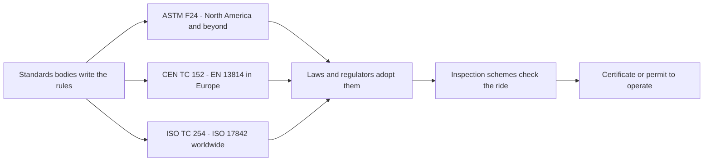

A ride standard is a rulebook written by volunteers: engineers, manufacturers, park operators, inspectors and regulators who sit on a committee and vote. On its own it is voluntary. It becomes law when a government writes "rides shall comply with ASTM F24" or "EN 13814" into its regulations, which is how most of the world works today.

Three families matter. [ASTM F24](../safety-standards/astm-f24.md) is the North American set, split into design, manufacturing, operation and audit practices. [EN 13814](../safety-standards/en-13814.md) is the European norm, and [ISO 17842](../safety-standards/iso-17842.md) is its international twin. They overlap heavily and committees formally liaise.

Who actually checks a ride is a separate question, answered by the [regulatory landscape](../safety-standards/regulatory-landscape.md) and [national inspection schemes](../safety-standards/national-inspection-schemes.md). For designers the practical effect is concrete: the standards set the [acceleration envelopes](../ride-engineering/acceleration-envelopes.md), restraint rules and documentation that every [design review](../design-process/design-reviews-and-gates.md) must satisfy before commissioning.

## Explore further
- `astm-f24-committee` — ASTM Committee F24 on Amusement Rides and Devices
- `genorma-en-13814-1` — EN 13814-1:2019+A1:2024 Safety of amusement rides, Part 1
- `iso-17842-1-2023` — ISO 17842-1:2023 Safety of amusement rides and devices, Part 1
- `ridesdatabase-saferparks-regulations` — Saferparks: Safety regulations for U.S. amusement rides
