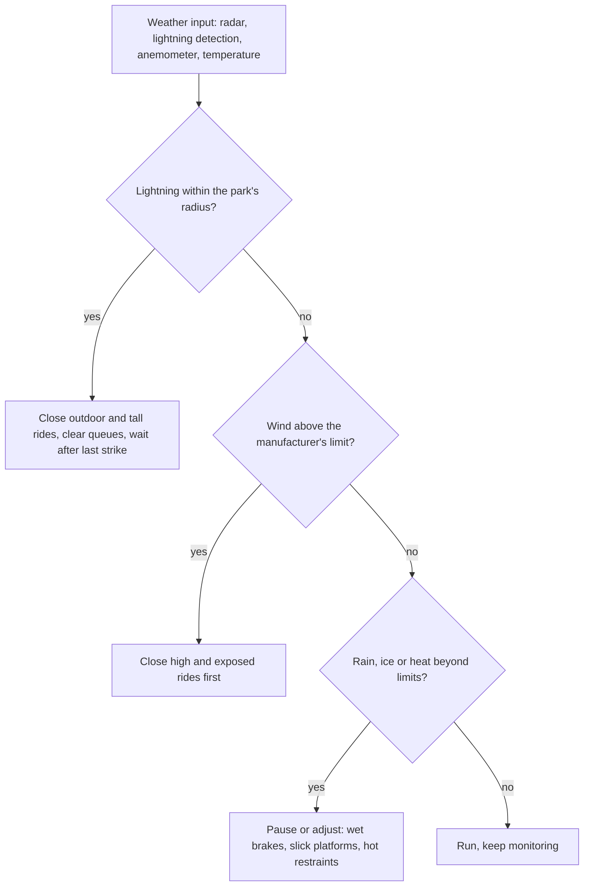

Lightning is the clearest. The US National Weather Service advice is blunt: if you can hear thunder you are close enough to be struck, and outdoor activity should stop until roughly thirty minutes after the last thunder. Parks translate this into detection systems and a closure radius that empties tall steel rides, lifts, towers and open queues, and a timed all-clear.

Wind comes from the manufacturer. Every ride manual states operating wind limits, and the UK's HSG175 reminds controllers to follow them and to anchor rides accordingly. Tall and exposed attractions such as [observation wheels](../ride-systems/observation-wheel.md) and [gondolas and skyrides](../ride-systems/gondolas-and-skyrides.md) close first, and a coaster train that runs light can stall in a headwind, a theme explored under [train mass and weather](../ride-engineering/train-mass-and-weather.md); reports on the 2015 Smiler incident describe the empty test train stalling after a gust before the fatal override. Rain, ice and heat add limits of their own.

The rules name who calls it, usually a duty manager with a weather feed, and how reopening is verified. Good policies are visible to guests and are part of the trade-off with [downtime and availability](../operations-business/downtime-and-availability.md), while [rain and weather design](../sensory-environment/rain-and-weather-design.md) decides how pleasant waiting out a storm can be.

## Explore further
- `nws-lightning-safety` — National Weather Service: Lightning safety tips and resources
- `hse-hsg175` — HSE HSG175: Fairgrounds and amusement parks, guidance on safe practice
- `astm-f770-operations` — ASTM F770 Ownership, Operation, Maintenance, and Inspection of Amusement Rides
