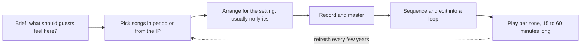

Area music, often called background music or BGM, is the loop that plays in a land all day. It does a job that scenery cannot: it fixes the date and the feeling before you have read a single sign. Disneyland's Main Street, U.S.A. plays turn-of-the-century arrangements; when the loop was refreshed in January 2012, the first change in about twenty years, over a dozen new period-style recordings were added, including a ragtime-era arrangement of a modern film theme so it still fit the street.

Loops are usually instrumental so they never fight speech, and they are long enough that a guest standing in one spot rarely hears the join. Magic Kingdom's 2020 Adventureland loop runs about fifteen minutes and replaced separate entrance and attraction loops with one land-wide bed. Area music is the public face of the [entry sequence](../masterplanning/entry-sequence.md), a quiet engine of [nostalgia](../human-factors/nostalgia.md) for returning guests, and a cheap way to blunt [queue boredom](../human-factors/queue-boredom.md). It is the opposite of [onboard and spatial audio](../show-technology/onboard-and-spatial-audio.md), which is synced to a vehicle; a loop must work at any moment, from any direction. Disneyland in 1955 set the pattern, and most parks since have copied it.

## Explore further
- `laughingplace-2012-main-street-loop` — Disneyland Updates Main Street Music Loop for First Time in 20 Years
- `wdwnt-adventureland-bgm-loop-2020` — Adventureland Debuts New Background Music Loop at the Magic Kingdom
