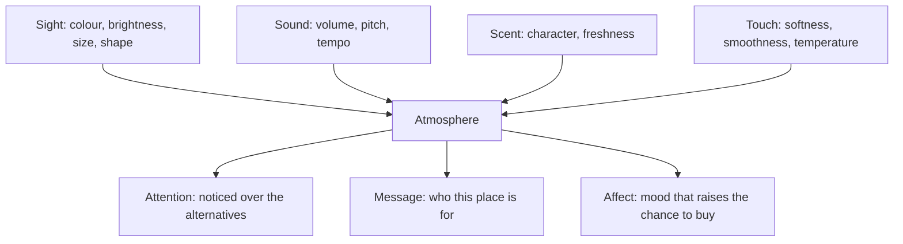

Philip Kotler's 1973 paper argued that buyers respond to the whole setting, not just the product, and that atmosphere can be designed on purpose. He split it into sight, sound, scent and touch, and gave it three jobs: attract attention, send a message about what the place is and whom it serves, and create a mood that makes buying more likely. Spangenberg and colleagues later found that an ambient scent changed how shoppers rated a store and how long they thought they had spent there; Aradhna Krishna's review maps similar effects for every sense.

A theme park is atmospherics at city scale. The gift shop at a ride exit is lit warmer and scented sweeter than the queue; a candy kitchen vents its sugar onto the street; music tempo nudges table turnover. Each is a lever on [per-capita spending](../operations-business/per-capita-spending.md) and a reason [food and retail placement](../masterplanning/food-and-retail-placement.md) is planned with the scenery. Aimed at story rather than sales, the same senses build [multisensory integration](../human-factors/multisensory-integration.md), and a scent or sound on a product becomes one of the [souvenirs and memory cues](../human-factors/souvenirs-and-memory-cues.md) guests take home. The caution is in [theme vs decoration](../story-experience/theme-vs-decoration.md): atmosphere without a story reads as a shop.

## Explore further
- `kotler-1973-atmospherics` — Atmospherics as a Marketing Tool
- `spangenberg-1996-olfactory-cues` — Improving the Store Environment: Do Olfactory Cues Affect Evaluations and Behaviors?
- `krishna-2012-sensory-marketing` — An Integrative Review of Sensory Marketing
