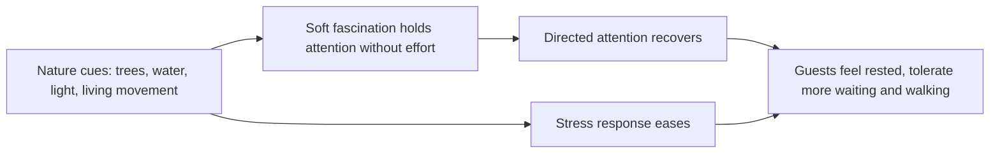

Biophilia is E. O. Wilson's 1984 word for the pull people feel toward other living things. The 1993 volume he edited with Stephen Kellert tested the idea against psychology and culture, and the practical evidence had already arrived: Roger Ulrich's 1984 study in Science found that surgical patients whose window faced trees went home sooner and asked for fewer strong painkillers than matched patients facing a brick wall. Stephen Kaplan's attention restoration theory explains the mechanism. Nature holds attention softly, without effort, so the tiring, deliberate kind of attention gets to recover.

A theme park spends guests' attention all day, so places to recover it matter. Planting beside a long queue, a stream through a plaza or a canopy of real trees is not decoration; it is the design response to [walking fatigue](../human-factors/walking-fatigue.md) and [queue boredom](../human-factors/queue-boredom.md), and it is why [rest areas](../masterplanning/rest-areas.md) that face greenery and water get used while those facing a wall do not. [Planting design](../sensory-environment/planting-design.md) is the main tool, and a big enough landscape, like a valley of floating mountains wrapped in real vegetation, tips over into [awe](../human-factors/awe.md). The rule: wherever guests must wait, walk or decide, give them something alive to look at.

## Explore further
- `openlibrary-wilson-biophilia` — Biophilia (Edward O. Wilson, 1984)
- `openlibrary-kellert-wilson-biophilia-hypothesis` — The Biophilia Hypothesis (Kellert & Wilson, eds., 1993)
- `ulrich-1984-view-through-window` — View Through a Window May Influence Recovery from Surgery
- `kaplan-1995-restorative-nature` — The Restorative Benefits of Nature: Toward an Integrative Framework
