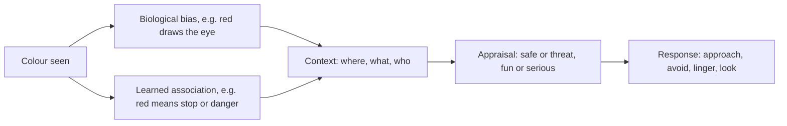

Colour psychology is the study of what seeing a colour does to us. Andrew Elliot and Markus Maier's review concludes that colour does affect mood, attention and behaviour, but the effects are smaller and more context-bound than popular posters suggest. Red can sharpen attention and signal danger on a warning sign, yet read as romantic on a restaurant wall. The colour carries a bias; the setting decides the meaning.

For designers this is freeing: a palette is designed with its context. John Hench chose colours for the story a land tells and for how the eye should move through it, not from a chart of "happy" and "sad" hues. Warm saturated colours on a facade pull [visual attention](../human-factors/visual-attention.md); the same colours on a fence would be a mistake, which is where [go-away green](../sensory-environment/go-away-green.md) takes over. Colour choices show up early in [mood boards](../design-process/mood-boards.md), get locked down in [signage and graphics](../design-process/signage-and-graphics.md), and help tune the line between [fear and fun](../human-factors/fear-vs-fun.md) in a dark ride: a scene lit red and green reads as a cartoon threat, the same scene in cold blue-white reads as a real one. Test palettes in place, under real light.

## Explore further
- `elliot-maier-2014-color-psychology` — Color Psychology: Effects of Perceiving Color on Psychological Functioning in Humans
- `hench-designing-disney` — Designing Disney: Imagineering and the Art of the Show
