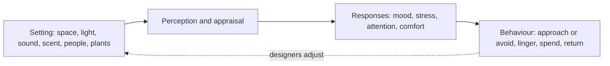

Environmental psychology asks a plain question: what does a place do to the people in it? Theme parks are a pure test case: every surface, sound and sightline was chosen, and the business depends on the answer. This group collects the theories park designers borrow most.

[Prospect-refuge](../sensory-environment/prospect-refuge.md) explains why guests gravitate to a sheltered seat with a view. [Biophilia](../sensory-environment/biophilia.md) explains why planting and water calm a crowd. [Servicescape](../sensory-environment/servicescape.md) and [atmospherics](../sensory-environment/atmospherics.md) come from marketing: Philip Kotler argued in 1973 that the designed atmosphere of a space is a selling tool, and Mary Jo Bitner's 1992 framework traced how ambient conditions, layout and signs shape both customers and staff. [Crowding and enclosure](../sensory-environment/crowding-and-enclosure.md) separates the number of people from the feeling of too many. [Visual complexity](../sensory-environment/visual-complexity.md) asks how much detail a scene can carry before it turns to noise.

The common thread is the loop in the diagram: a setting is perceived, it produces a response, the response becomes behaviour, and designers tune the setting again. It feeds [land design](../masterplanning/land-design.md), governs how [personal space and density](../human-factors/personal-space-and-density.md) feel in queues, underpins [presence](../human-factors/presence.md), shapes the working environment behind [service culture](../operations-business/service-culture.md), and gives [guest research](../operations-business/guest-research.md) its hypotheses.

## Explore further
- `bitner-1992-servicescapes` — Servicescapes: The Impact of Physical Surroundings on Customers and Employees
- `kotler-1973-atmospherics` — Atmospherics as a Marketing Tool
