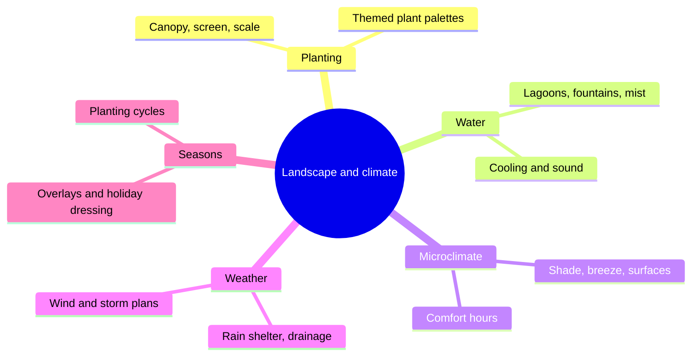

Most of a theme park is outside, and the outdoors has to be designed as carefully as any show building. This group gathers the living and climatic half of the environment. [Planting design](../sensory-environment/planting-design.md) is the oldest craft here: Bill Evans turned Anaheim orange groves into Disneyland's jungle within a year and set the idea that plants are scenery. [Water features](../sensory-environment/water-features.md) add sound, movement and cooling, and sometimes become the show itself. [Shade and microclimate](../sensory-environment/shade-and-microclimate.md) decides whether guests stay or flee in August; research reviewed by Chen and Ng shows that local sun, shade and wind strongly change how long people linger outdoors. [Rain and weather design](../sensory-environment/rain-and-weather-design.md) keeps the day going when the forecast turns, and [seasonal overlays](../sensory-environment/seasonal-overlays.md) re-dress the same spaces so they feel new in October and December.

The links outward are practical. The group inherits site thinking from [landscape architecture](../masterplanning/landscape-architecture.md), it is the main lever on [thermal comfort](../human-factors/thermal-comfort.md), it supplies [the berm](../story-experience/the-berm.md) with its trees, and it works alongside operational [weather policies](../safety-standards/weather-policies.md). A comfortable, sheltered, green park is one guests stay in longer.

## Explore further
- `d23-bill-evans` — Bill Evans — Disney Legend
- `chen-ng-2012-outdoor-thermal-comfort` — Outdoor Thermal Comfort and Outdoor Activities: A Review of Research in the Past Decade
