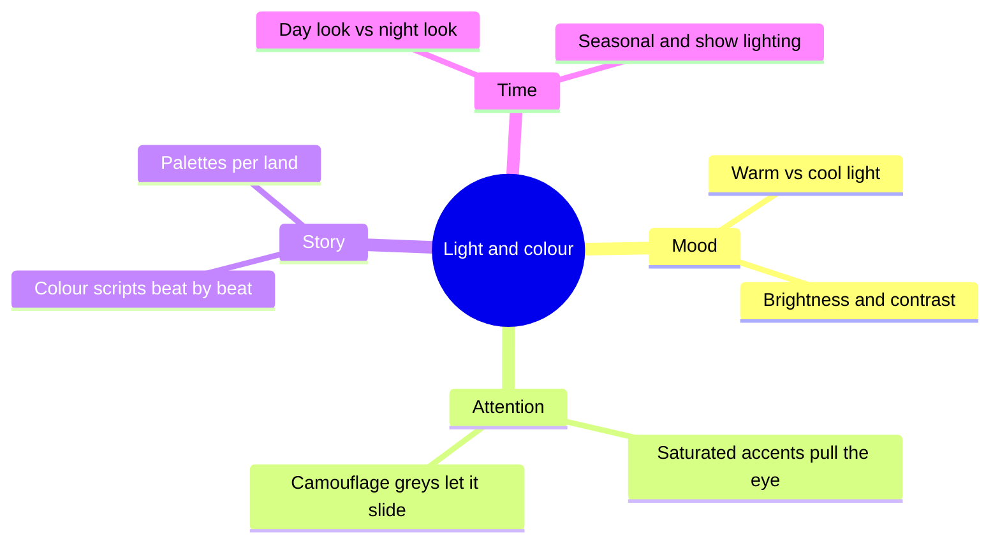

Colour is the cheapest material in a park and the one guests read fastest. John Hench, who shaped Disney's palettes for decades, treated colour as a show element in its own right: a saturated accent tells the eye where to go, a muted grey-green tells it to move on. That split, highlight versus camouflage, is the heart of this group. [Colour psychology](../sensory-environment/color-psychology.md) covers what hues do to mood and attention, with the caution from Elliot and Maier's review that most effects depend heavily on context. [Go-away green](../sensory-environment/go-away-green.md) is the camouflage half.

Light is colour that changes with the clock. The warmth of a lamp, set out under [lighting mood](../sensory-environment/lighting-mood.md), decides whether a street feels cosy or clinical; the switch from a day look to a night look, under [night vs day](../sensory-environment/night-vs-day.md), can make one land into two. [Colour scripts](../sensory-environment/color-scripts.md) borrow a feature-animation tool to plan how all of this changes beat by beat along a ride. In practice the group feeds [art direction](../design-process/art-direction.md), the paint schedules of [themed facades](../design-process/themed-facades.md), and the cue lists of [theatrical lighting](../show-technology/theatrical-lighting.md). It also governs [visual attention](../human-factors/visual-attention.md): what is lit and coloured is what gets seen.

## Explore further
- `hench-designing-disney` — Designing Disney: Imagineering and the Art of the Show
- `elliot-maier-2014-color-psychology` — Color Psychology: Effects of Perceiving Color on Psychological Functioning in Humans
