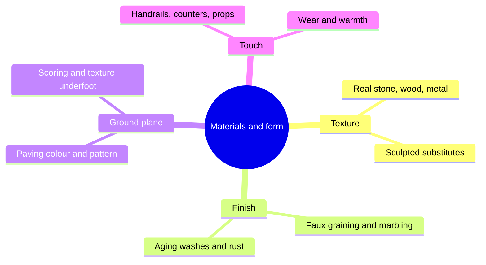

Guests read materials by eye at twenty metres and by hand at arm's length, and a themed environment has to pass both tests. This group covers the physical stuff of a land: what a wall is actually made of, what it is painted to look like, how old it pretends to be, what the ground says underfoot, and what happens when ten thousand hands a day touch it.

The craft sits between art and maintenance. [Materials and texture](../sensory-environment/materials-and-texture.md) covers the choice between a real material and a sculpted or cast substitute. [Faux finishes and aging](../sensory-environment/faux-finishes-and-aging.md) is the paint that turns plywood into oak and makes a new building look two hundred years old, the same skill set as [scenic painting](../design-process/scenic-painting.md) on a larger canvas. [Ground plane storytelling](../sensory-environment/ground-plane-storytelling.md) treats paving as a scene, and [tactile design](../sensory-environment/tactile-design.md) looks at what guests touch.

Form matters as much as surface. [Rockwork](../design-process/rockwork.md) and [themed facades](../design-process/themed-facades.md) are sculpted so edges, joints and proportions match the story's period and place; a Victorian cornice at the wrong scale breaks the spell. Done right, material honesty holds [suspension of disbelief](../human-factors/suspension-of-disbelief.md); done cheaply, it becomes the first item on the [preventive maintenance](../operations-business/preventive-maintenance.md) list.

## Explore further
- `hench-designing-disney` — Designing Disney: Imagineering and the Art of the Show
- `rosco-merlin-scenic-aging` — Creating Realistic Themed Scenery & Props Using Rosco Supersat Paints
