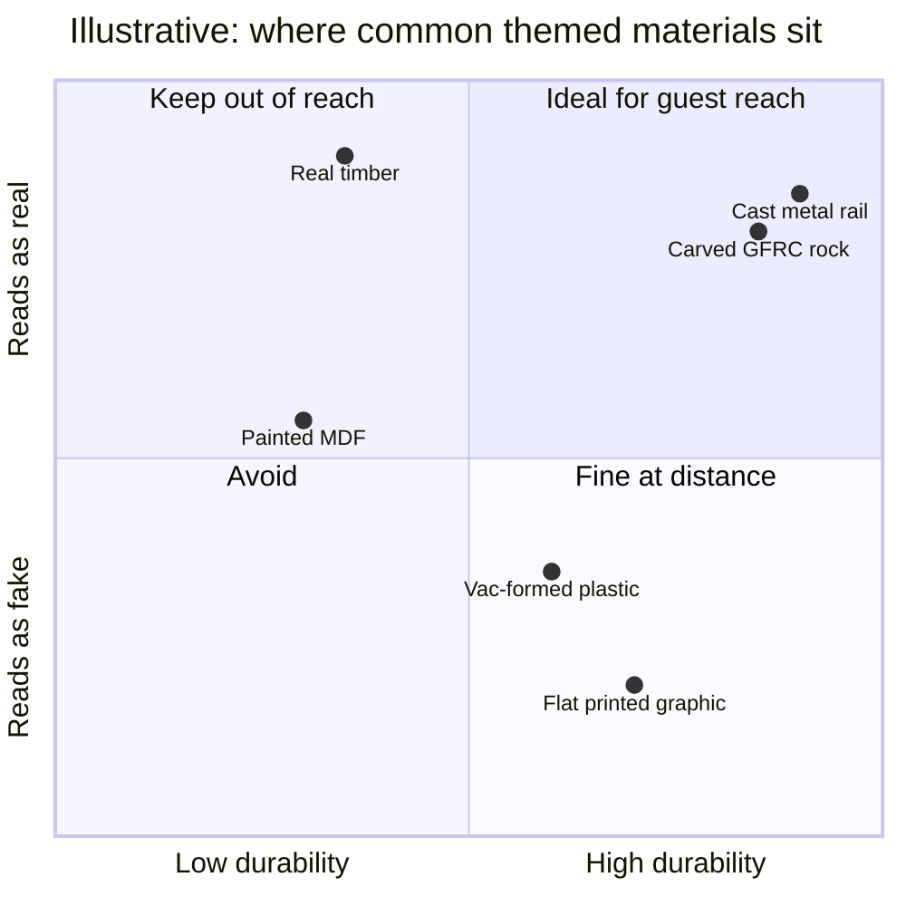

Texture is what tells the eye that a surface is stone and not painted foam, and the eye is hard to fool at close range. Theme park fabrication therefore sorts every surface by two questions: how close will guests get, and what will the weather and the crowd do to it? Real timber, iron and stone win on authenticity but rot, rust and cost. Glass-fibre reinforced concrete, cast resin and vacuum-formed plastic win on durability and weight, and depend on paint and sculpted texture to pass. A Merlin scenic artist describes turning MDF into aged wood and vac-formed plastic into old barrels with graining and washes; that is the normal case.

Scale sets the rules. Mortar joints, wood grain and tool marks must be sized for the viewing distance; a facade seen from across a plaza needs coarser, deeper texture than a queue wall at arm's length, a point that connects to [scale and intimacy](../story-experience/scale-and-intimacy.md). [Rockwork](../design-process/rockwork.md) and [themed facades](../design-process/themed-facades.md) are the big examples. Outdoors, real materials and fake ones age differently, so [corrosion and weathering](../ride-engineering/corrosion-and-weathering.md) has to be planned rather than discovered. Done right, texture quietly holds [suspension of disbelief](../human-factors/suspension-of-disbelief.md); done wrong, the first fingernail test ends the story.

## Explore further
- `rosco-merlin-scenic-aging` — Creating Realistic Themed Scenery & Props Using Rosco Supersat Paints
- `hench-designing-disney` — Designing Disney: Imagineering and the Art of the Show
