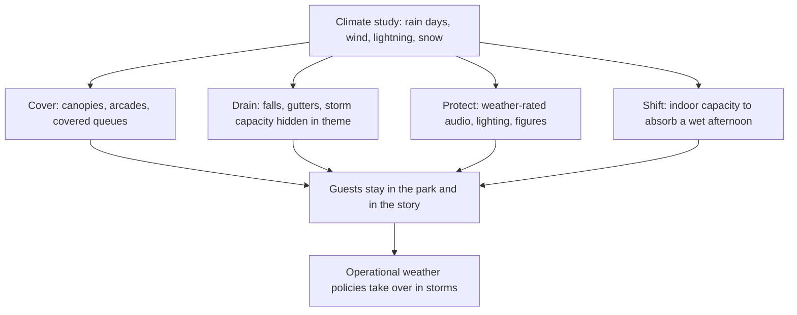

Rain is not an exception; in most climates it is a third of the year. The question is whether a wet afternoon ends the visit or just changes it. Tokyo Disneyland answered it structurally: World Bazaar is a Main Street under a permanent canopy, built for a city with long rainy seasons. Florida parks lean on covered queues and indoor pre-shows, so a storm moves crowds rather than sending them home.

Good weather design works at four levels. Cover, so guests can keep moving between attractions and queues stay full; a themed arcade or awning counts, and a covered [queue](../story-experience/queue-storytelling.md) is a chance for more story. Drainage, sized for storms and hidden in the theme as culverts and swales. Protection for show hardware, from weather-rated loudspeakers as at Shanghai Happy Valley's lake show to drained figure pits, with [corrosion and weathering](../ride-engineering/corrosion-and-weathering.md) planned for. And capacity: a park needs enough indoor attractions to absorb a wet hour, a [capacity planning](../masterplanning/capacity-planning.md) problem that [indoor parks](../masterplanning/indoor-parks.md) solve wholesale.

Beyond that line, design hands over to [weather policies](../safety-standards/weather-policies.md): lightning distances, wind limits for tall rides, when to close. Wind and rain cut outdoor dwell time sharply, so cover near food and retail pays twice.

## Explore further
- `wikipedia-tokyo-disneyland` — Tokyo Disneyland
- `dbaudio-happy-valley-lake-of-illusions` — Storytelling Whatever the Weather at Shanghai's Happy Valley
- `chen-ng-2012-outdoor-thermal-comfort` — Outdoor Thermal Comfort and Outdoor Activities
