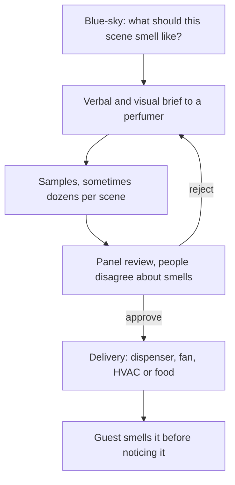

Scent design is the least visible craft in a theme park and often the most remembered. Imagineer Gary Powell calls smell a "memory enhancer": a whiff of orange blossom or gunpowder can bring back a whole afternoon years later. That is why [scent and memory](../human-factors/scent-and-memory.md) sits at the centre of this group, and why scents are planned at the blue-sky stage rather than added at the end.

The process is surprisingly like casting. Imagineers describe a scene in words and pictures to a perfumer, review sample after sample, and reject most of them because people disagree sharply about smells. The Soarin' sea-breeze scent reportedly failed its first review and was redone from the smell of socks soaked in the Pacific. Delivery is the engineering half, covered under [smellitzers](../sensory-environment/smellitzers.md) and the wider family of [wind, heat and scent effects](../show-technology/wind-heat-and-scent-effects.md). Scent also pays for itself: a Main Street candy kitchen venting sugar onto the street is both atmosphere and [food and retail placement](../masterplanning/food-and-retail-placement.md). Because smell combines with sight and sound rather than competing with them, it is a cheap way to strengthen [multisensory integration](../human-factors/multisensory-integration.md) in a scene.

## Explore further
- `micechat-smells-of-storytelling` — How Disney Imagineers Unlock the Smells of Storytelling
- `krishna-2012-sensory-marketing` — An Integrative Review of Sensory Marketing
