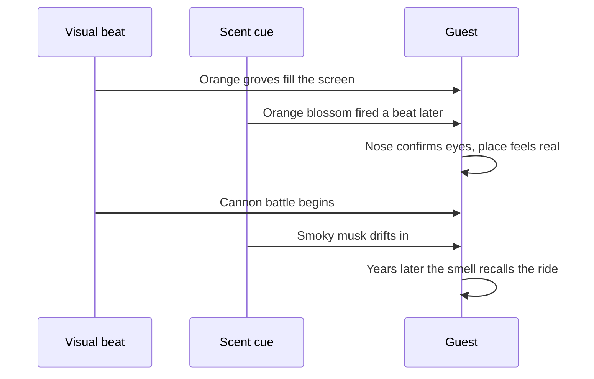

A smell on its own is just a smell. Fired a second after the matching picture, it becomes evidence: the orange groves in Soarin' Over California were paired with orange blossom, the harbour flyover with a sea-breeze scent, and the cannon fight in Pirates of the Caribbean with a smoky musk. The nose confirms what the eyes report, and the scene stops being a set. This is planned on the [ride beat sheet](../story-experience/ride-beat-sheet.md) alongside lighting and sound.

Two findings explain why it works. Rachel Herz found that memories triggered by odour feel more emotional and more vividly "brought back" than the same memories cued by a picture or a sound, which is the basis of [scent and memory](../human-factors/scent-and-memory.md). Spangenberg and colleagues showed that an ambient scent changes how people rate a space and even how long they think they spent in it. Scent also leans on [cross-modal effects](../human-factors/cross-modal-effects.md): a sweet smell makes warm light feel warmer. The rules are simple. One scent per scene, fired after the visual, never two in a row, and a neutral gap so noses reset. Holiday versions of it's a small world swap in seasonal scents for [seasonal overlays](../sensory-environment/seasonal-overlays.md).

## Explore further
- `herz-2004-scent-memory` — A Naturalistic Analysis of Autobiographical Memories Triggered by Olfactory, Visual and Auditory Stimuli
- `micechat-smells-of-storytelling` — How Disney Imagineers Unlock the Smells of Storytelling
- `spangenberg-1996-olfactory-cues` — Improving the Store Environment: Do Olfactory Cues Affect Evaluations and Behaviors?
