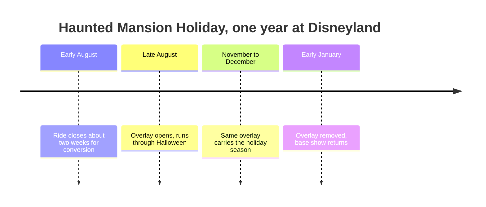

A seasonal overlay changes what guests see, hear and smell in a familiar place without changing its bones. The model case is Haunted Mansion Holiday at Disneyland, opened on 3 October 2001 and back nearly every year since. For about two weeks each August the ride closes while crews swap in Nightmare Before Christmas props: jack-o'-lanterns and a coffin sleigh outside, stained-glass scenes in place of the stretching portraits, a gingerbread house in the ballroom, snow and skeletal reindeer in the graveyard, and a new score. In January it all comes out again. Tokyo Disneyland runs its own version, opened in 2004.

What makes an overlay work is that every layer changes together. Props are the visible part, but the music loop, narration, lighting cues and even scents are swapped; holiday versions of it's a small world add seasonal smells. The practice sits inside [retheming and overlays](../operations-business/retheming-and-overlays.md) at the light end, with no structural work, and it is the design half of [seasonality and events](../operations-business/seasonality-and-events.md): a reason for locals to return in a slow quarter. Install windows are booked into [entertainment scheduling](../operations-business/entertainment-scheduling.md) months ahead. The payoff is [nostalgia](../human-factors/nostalgia.md) on a yearly cycle. The [Haunted Mansion](../history/haunted-mansion.md) remains the best-documented example.

## Explore further
- `wikipedia-haunted-mansion-holiday` — Haunted Mansion Holiday
- `micechat-smells-of-storytelling` — How Disney Imagineers Unlock the Smells of Storytelling
