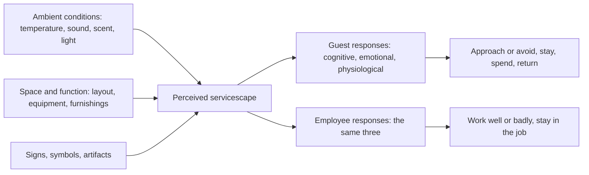

In 1992 Mary Jo Bitner gave a name to something park designers already practised: the servicescape, the built environment in which a service happens. Her framework sorts the setting into three groups, ambient conditions, spatial layout and function, and signs, symbols and artifacts, and traces how each is perceived and turned into thoughts, feelings and bodily responses. Two things made it useful: it treats employees as occupants of the same space, and it ends in behaviour, approach or avoid, linger or leave, return or not.

For a ride, the servicescape runs from queue entrance to exit shop. Ambient conditions are the shade, loop and scent; layout is the switchbacks, the merge point and [load and unload design](../operations-business/load-unload-design.md); signs are the height stick, the wait board and the [signage hierarchy](../human-factors/signage-hierarchy.md) that tells guests where to stand. Get the setting right and the [perceived wait](../human-factors/perceived-vs-actual-wait.md) shrinks below the measured one; get it wrong and no amount of friendliness fixes it. The employee half is just as practical: an operator booth with sightlines, shade and a place to sit supports [service culture](../operations-business/service-culture.md) more reliably than a training video. Bitner's chain is also the easiest way to explain [level of service](../masterplanning/level-of-service.md) targets to designers.

## Explore further
- `bitner-1992-servicescapes` — Servicescapes: The Impact of Physical Surroundings on Customers and Employees
- `kotler-1973-atmospherics` — Atmospherics as a Marketing Tool
