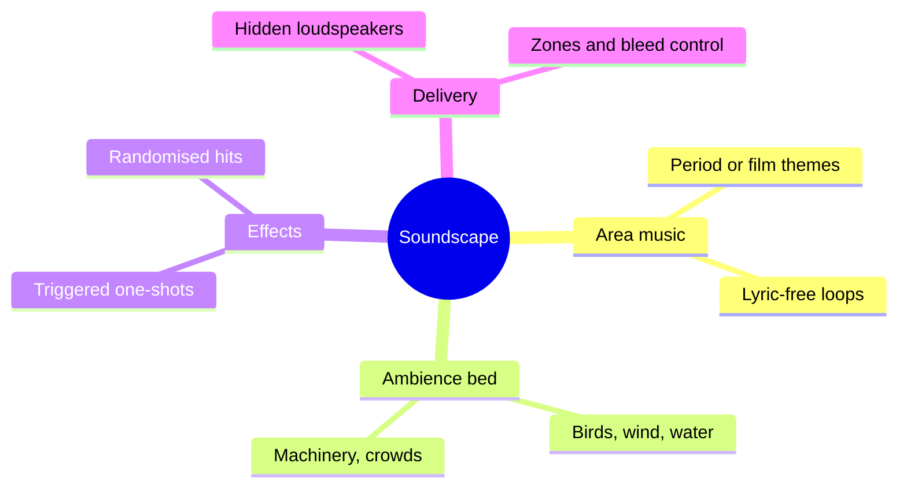

A soundscape is everything you hear in a land that is not a ride vehicle or a live performer. Designers build it in three layers: a music loop that sets the period and mood, an ambience bed of natural or mechanical sound that makes the place feel inhabited, and short effects that fire on timers or sensors. The layers are mixed per zone and played through loudspeakers hidden in rockwork, lamp posts and planters, as Liseberg did when it rebuilt its Rabbit Land children's area with a networked show-control system.

Sound is the fastest way to create [presence](../human-factors/presence.md) because the ear cannot look away. It also carries story: a creaking sign or a distant foghorn is [environmental storytelling](../story-experience/environmental-storytelling.md) without a single prop. The hard part is the edges. Soundscapes must change cleanly at [land transitions](../masterplanning/land-transitions.md), stay out of the way of [onboard and spatial audio](../show-technology/onboard-and-spatial-audio.md) inside attractions, and respect [noise exposure](../human-factors/noise-exposure.md) limits for staff who hear the loop all day. Joe Rohde described Pandora's evening soundscape shifting hour by hour so that guests who pay attention notice the land itself has changed.

## Explore further
- `lsi-liseberg-rabbit-land-meyer-sound` — Rabbit Land Comes Alive with Meyer Sound (Liseberg)
- `d23-pandora-details` — Don't Miss These Amazing Disney Details in Pandora
