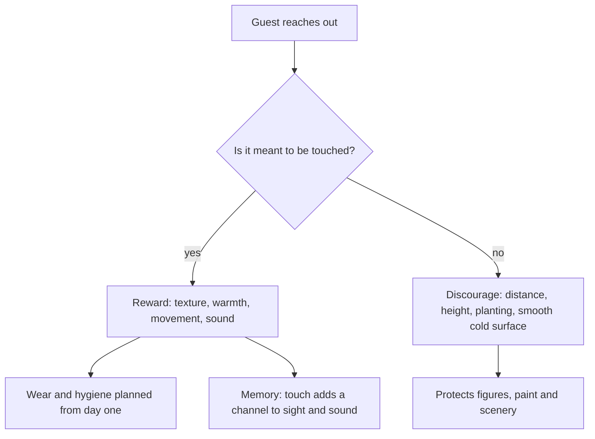

People touch what they can reach, so a designer either plans for it or pays for it. Tactile design treats touch as a channel in its own right. Aradhna Krishna's review of sensory marketing shows that handling an object raises felt ownership and value; in a park, a hand on rough stone or a warm wooden rail does the same for the story. Pandora takes the idea furthest, with sculpted plants that respond when guests touch them, using motion-sensor technology from Disney Research.

Good tactile design answers three questions. What should feel like what: cold cast iron in a Victorian street, warm splintery timber in a frontier town, smooth river stone in a grotto. What may be touched: those surfaces get durable, cleanable finishes and a wear allowance, while fragile scenery is kept out of reach. And what the touch gives back: a crank that turns, a drum that lights, a stone that hums, which is the engine of [interactive queues](../human-factors/interactive-queues.md) and of [play and exploration](../human-factors/play-and-exploration.md) by children. Touch also carries [accessibility](../human-factors/accessibility.md): tactile maps, textured guide strips and handrails serve blind guests, and calmer textures belong in [sensory guides and quiet rooms](../human-factors/sensory-guides-and-quiet-rooms.md). Each touch adds a channel to [multisensory integration](../human-factors/multisensory-integration.md).

## Explore further
- `krishna-2012-sensory-marketing` — An Integrative Review of Sensory Marketing
- `wikipedia-pandora-world-of-avatar` — Pandora – The World of Avatar
