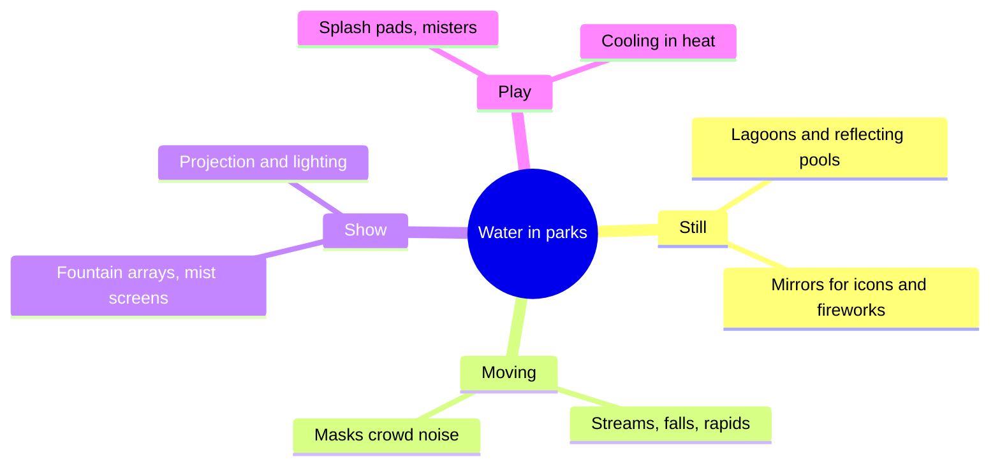

Water does four things no other material can. It moves and catches light, so a lagoon is never the same picture twice. It makes sound, and falling water is the friendliest noise mask, covering crowd chatter and machinery. It cools, by evaporation and by inviting people to stand near it. And it reflects, doubling a castle or a firework for free. Disneyland used water this way from the start: the castle moat and the Rivers of America are both scenery and separation.

At the large end water becomes the show. World of Color at Disney California Adventure, opened in June 2010, uses roughly 1,200 fountains with LED rings in Paradise Bay, some reaching about 200 feet, plus mist screens that join into a 380-foot projection surface. That is the territory of [water screens and fountains](../show-technology/water-screens-and-fountains.md) and [nighttime spectaculars](../show-technology/nighttime-spectaculars.md), and it shows why a lagoon is often placed in front of a [central icon](../masterplanning/central-icon.md): the water is the auditorium.

At the small end water is relief. A stream beside a path or a fountain in a [rest area](../masterplanning/rest-areas.md) gives tired guests somewhere to look, which is the everyday face of [biophilia](../sensory-environment/biophilia.md). Water also needs filtration, safety edges and a winter plan.

## Explore further
- `wikipedia-world-of-color` — World of Color
- `hench-designing-disney` — Designing Disney: Imagineering and the Art of the Show
