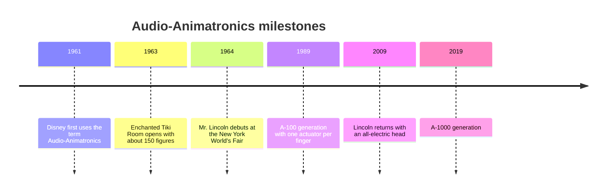

The Enchanted Tiki Room opened at Disneyland on 23 June 1963 with roughly 150 birds, flowers and tiki drummers. Tones recorded on tape vibrated a metal reed, which closed a relay and fired a pneumatic valve, so early movement was mostly on or off. A room full of computers under the show floor played the tapes.

One year later, at the [1964 World's Fair](../history/worlds-fair-1964.md), Great Moments with Mr. Lincoln showed a human figure convincing enough to pass without a puppeteer. The Disneyland version of 1965 had 48 body movements plus 17 in the head and face. Analog control then brought smooth, continuous motion; hydraulics powered large figures while pneumatics handled light limbs, the recipe behind [Pirates of the Caribbean](../history/pirates-of-the-caribbean.md).

The A-100 series of 1989 gave each finger its own actuator. In December 2009 Lincoln returned with all-electric head actuators, and the A-1000 generation followed in 2019. The trajectory is clear: fewer hoses, more functions, and more work for the [figure programmer](../show-technology/figure-programming.md) and the [Imagineers](../history/legendary-imagineers.md) who direct them.

## Explore further
- `wikipedia-audio-animatronics` — Audio-Animatronics
- `wikipedia-enchanted-tiki-room` — Enchanted Tiki Room
- `wikipedia-great-moments-with-mr-lincoln` — Great Moments with Mr. Lincoln
