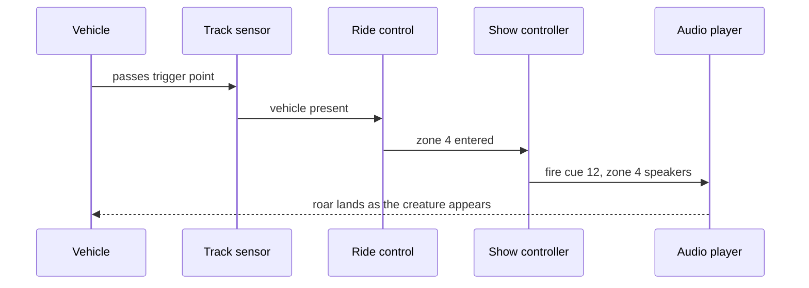

A dark ride cannot run its whole soundtrack on a stopwatch, because vehicles bunch, pause and restart. Instead, sound is triggered by position. A sensor on the track, a proximity switch or the ride control system's own block logic tells the show controller that a vehicle has entered a zone, and the controller fires that zone's cue on its local speakers. Alcorn McBride controllers do exactly this, taking inputs from [ride sensors](../ride-engineering/sensors-and-switches.md) and cueing audio, lights and effects. The craft is placing each trigger so the sound peaks when eyes reach the effect.

Masking is the quieter craft. Tyres, chains, valves and pumps all leak into the show. Sound masking adds deliberate sound, often a broad-band bed like wind, water or a rumble, so the mechanical noise becomes less noticeable, the same principle offices use.

Together, triggers and masking keep [operational intrusion](../human-factors/operational-intrusion.md) out of the story, give [misdirection](../show-technology/misdirection.md) its sound cues, and define each scene's [audio zone](../sensory-environment/audio-zoning.md). The limit is loudness: masking beds raise overall level, which has to stay inside [noise exposure](../human-factors/noise-exposure.md) limits for the operators who hear it all day.

## Explore further
- `wikipedia-sound-masking` — Sound masking
- `alcorn-mcbride-show-control` — Alcorn McBride: show control, audio and video
- `huntington-show-networks-book` — Show Networks and Control Systems
