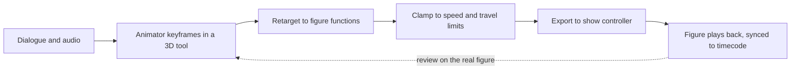

Early figures were "programmed" by recording tones that fired valves on or off. Today a figure is animated much like a film character. An animator sets keyframes in a 3D package against the dialogue track, one curve per function: jaw, brow, eye pan, head nod, and so on. Those curves are then retargeted to the real machine, which has fixed travel, speed and acceleration limits, so a fast cartoon snap may have to become a slower, heavier move.

The result is loaded onto the show controller and played on [timecode](../show-technology/ride-show-synchronization.md) with the audio, lights and effects. Because the figure runs the same program thousands of times, every frame gets reviewed on the physical figure, not just the screen; small timing slips are what push a character into the [uncanny valley](../human-factors/uncanny-valley.md).

Research is closing the gap between animation and machine. Disney Research's 2013 work on computational design built linkages that reproduce a given animated motion, and its 2024 Robot Motion Diffusion Model generates animation-style motion that a physics controller can actually execute, a bridge toward [learned figure control](../ai-future/rl-for-figures.md). The craft still starts with a [performance](../story-experience/scripts-and-performance.md) and the animator's [toolkit](../careers/software-toolkit.md).

## Explore further
- `coros-2013-mechanical-characters` — Computational Design of Mechanical Characters
- `disney-research-robot-motion-diffusion` — Robot Motion Diffusion Model
- `wikipedia-audio-animatronics` — Audio-Animatronics
