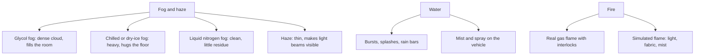

Fog is the workhorse. Glycol or glycerin fluid heated in a fog machine makes a dense white cloud that fills a room; chill the same fog with ice, a compressor or dry ice and it turns heavy and crawls along the floor, the classic graveyard look. Dry ice in hot water gives cheap low fog that drifts with air currents; liquid nitrogen makes a clean fog that leaves almost no residue. Haze is different: a thin, even mist whose job is to make light beams visible, which is why [theatrical lighting](../show-technology/theatrical-lighting.md) designers ask for it.

Water effects range from a timed splash on a boat ride to rain bars and geysers, and they share plumbing with the park's [water features](../sensory-environment/water-features.md). Fire is the most dramatic and most regulated. Real gas flame needs interlocks, sensors and a purge cycle; Fantasmic! at Disneyland has used fire effects on its lagoon since 1992. Simulated flame from vendors like Technifex uses light, fabric or mist to get most of the look with little of the hazard.

Every effect draws on the [central plant](../masterplanning/utilities-and-central-plant.md), carries a [risk assessment](../safety-standards/risk-assessment.md), and needs [preventive maintenance](../operations-business/preventive-maintenance.md): fog fluid residue, clogged nozzles and worn igniters are daily realities.

## Explore further
- `wikipedia-theatrical-smoke-and-fog` — Theatrical smoke and fog
- `technifex-effects` — Technifex: special effects and show systems
- `wikipedia-fantasmic` — Fantasmic!
