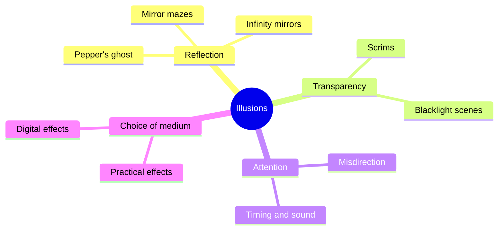

Most dark-ride magic was invented for Victorian theatres. A sheet of glass at 45 degrees puts a transparent ghost in a ballroom. A loosely woven scrim is a wall until the light moves behind it. Two mirrors make a corridor endless. Ultraviolet light lets painted props float in a room the eye cannot see. And a magician's rule, that attention goes where motion and sound go, decides when a set change can happen unseen.

The Haunted Mansion is the textbook: Yale Gracey and Rolly Crump were put in charge of its illusions, and its ballroom became the most famous Pepper's ghost scene anywhere. Each family gets a card here: [Pepper's ghost](../show-technology/peppers-ghost.md), [scrims](../show-technology/scrims-and-transparency.md), [mirrors](../show-technology/mirrors-and-infinity-rooms.md), [blacklight](../show-technology/blacklight-and-uv-paint.md), [misdirection](../show-technology/misdirection.md), and the [practical versus digital](../show-technology/practical-vs-digital-effects.md) choice behind all of them.

These tricks work because they exploit the same [optical illusions](../human-factors/optical-illusions.md) and expectations the eye brings to every room. Paired with [forced perspective](../story-experience/forced-perspective.md) and careful [reveals](../story-experience/reveal-and-concealment.md), they buy the guest's [suspension of disbelief](../human-factors/suspension-of-disbelief.md) for pennies compared with media.

## Explore further
- `wikipedia-peppers-ghost` — Pepper's ghost
- `wikipedia-the-haunted-mansion` — The Haunted Mansion
- `macknik-2008-stage-magic` — Attention and awareness in stage magic
