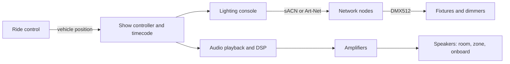

Lighting and audio are the two show systems guests never notice when they work. Light gives visibility, shape, focus and mood, and it is the cheapest way to make a scene appear or vanish. Sound carries story, masks machinery and, through onboard speakers, follows each rider through the building. Both are cued from the same show controller and often from the same timecode, so a thunder crack and a lightning flash land in the same frame.

The cards in this group follow the signal path. [Theatrical lighting](../show-technology/theatrical-lighting.md) covers fixtures, gobos and colour. [Control protocols](../show-technology/lighting-control-protocols.md) explain DMX512, Art-Net and sACN, the languages between console and fixture. [Onboard and spatial audio](../show-technology/onboard-and-spatial-audio.md) puts speakers in the seat. [Triggers and masking](../show-technology/audio-triggers-and-masking.md) tie sound to vehicle position and hide the noise of the ride system. The [sound design pipeline](../show-technology/sound-design-pipeline.md) follows a cue from script to playback.

The land next door owns the atmosphere these systems create, in [lighting mood](../sensory-environment/lighting-mood.md) and [area music](../sensory-environment/area-music.md); this land owns the hardware, the protocols and the [people](../careers/show-tech-roles.md) who program it.

## Explore further
- `wikipedia-stage-lighting` — Stage lighting
- `huntington-show-networks-book` — Show Networks and Control Systems
- `qlab-docs` — QLab 5 documentation
