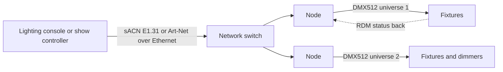

DMX512 is the lingua franca of entertainment lighting. Created in 1986 by the USITT Engineering Commission to replace proprietary dimmer links, it sends one universe of 512 channels, each a value from 0 to 255, as an asynchronous serial stream at 250 kbit/s over EIA-485 differential wiring. A dimmer uses one channel; a moving head may use twenty. ESTA took over the standard, ANSI approved DMX512-A in November 2004, and the current edition is ANSI E1.11-2024. RDM, ANSI E1.20, adds a return path so fixtures can report status and be addressed remotely.

A ride can need hundreds of universes, which is where Ethernet carriers come in. Art-Net, written by Wayne Howell of Artistic Licence and published royalty-free, wraps DMX and RDM in network packets and supports tens of thousands of universes. sACN, ANSI E1.31, is the open ESTA alternative. Nodes convert back to DMX for the last run.

These networks are show networks, deliberately separate from the [ride control system](../safety-standards/ride-control-systems.md) that protects life safety; a lighting fault must never stop a brake. They are part of the broader [show control](../show-technology/show-control-systems.md) stack, standard entries in a designer's [software toolkit](../careers/software-toolkit.md), and the plumbing behind every [lighting mood](../sensory-environment/lighting-mood.md) cue.

## Explore further
- `wikipedia-dmx512` — DMX512
- `art-net-spec` — Art-Net: DMX512 and RDM over Ethernet
- `esta-published-standards` — ESTA published standards (E1.11, E1.20, E1.31)
