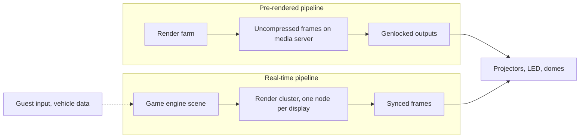

A media server is a computer built to play very large video, uncompressed if needed, to many outputs with every frame aligned. A dome or bank of projectors must receive the same frame at the same instant or the blend tears. 7thSense builds servers for this, with pixel processing to keep images synchronised and Medialon show control to cue them. Avatar Flight of Passage shows the top of the pre-rendered world: 10K resolution, 60 frames per second, in stereo.

The real-time pipeline swaps the stored frames for a running game engine. Unreal Engine's nDisplay runs one instance per machine, each rendering its own screen's viewport, with a primary node sharing input so the cluster acts as one image. disguise's RenderStream pipes engine output through its platform, and 7thSense supports Unreal, Notch and TouchDesigner.

Pre-rendered still wins on image quality per dollar. Real-time wins when the picture must respond, to a guest's aim, a vehicle's actual position or a choice made in the queue, which is the foundation of [interactive](../ride-systems/interactive-dark-ride.md) and [personalized](../ai-future/personalized-dark-rides.md) dark rides and of [real-time engines](../ai-future/real-time-engines.md) as a design medium. The same engine doubles as the [previs](../design-process/previs.md) tool, so it now sits in every show designer's [toolkit](../careers/software-toolkit.md).

## Explore further
- `7thsense-media-servers` — 7thSense: media servers and Medialon show control
- `disguise-media-platform` — disguise: real-time visual experience platform
- `unreal-ndisplay-docs` — nDisplay overview for Unreal Engine
