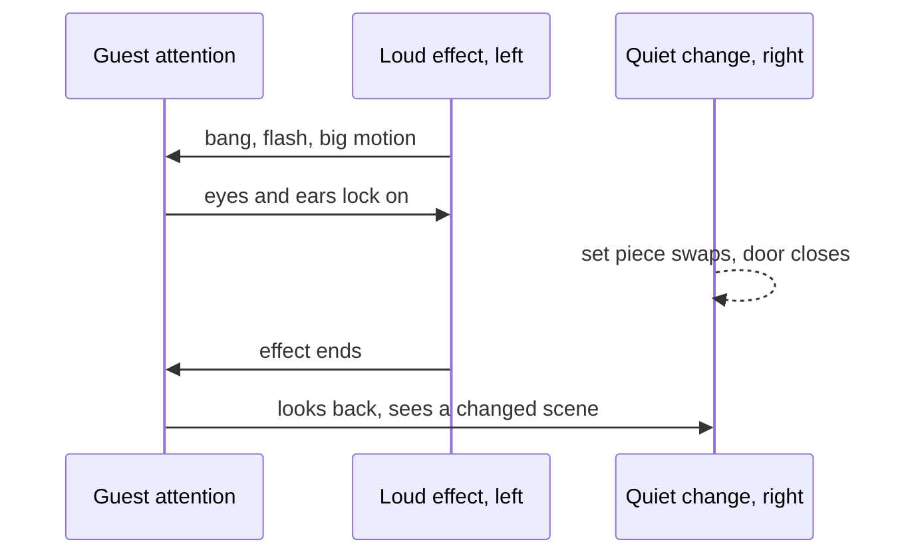

Magicians knew long before neuroscience measured it: attention is a narrow spotlight, and it is pulled by motion, sudden sound, bright light and faces. A 2008 paper in Nature Reviews Neuroscience, written by Macknik and Martinez-Conde with working magicians including Teller and Apollo Robbins, lays out how performers manipulate attention and awareness.

Dark rides apply the same principles. A large, fast movement on one side of the vehicle hides a small one on the other. A sound cue placed just before a set change, not during it, pulls eyes away in time. A scene ending in a flash lets the next scene load in darkness. Timing is set in the show controller, which is why [show action equipment](../show-technology/show-action-equipment.md) and effects are cued relative to the moment of maximum distraction rather than the moment they are needed.

Failure teaches the rule. The original Hatbox Ghost of 1969 was pulled because ambient light let guests see the head that was supposed to vanish; no amount of misdirection beats a lit secret. The discipline draws straight from the [borrowed craft](../story-experience/borrowed-crafts.md) of stage magic, feeds every [reveal](../story-experience/reveal-and-concealment.md), and depends on how [visual attention](../human-factors/visual-attention.md) actually behaves in a moving vehicle.

## Explore further
- `macknik-2008-stage-magic` — Attention and awareness in stage magic
- `wikipedia-hatbox-ghost` — Hatbox Ghost
