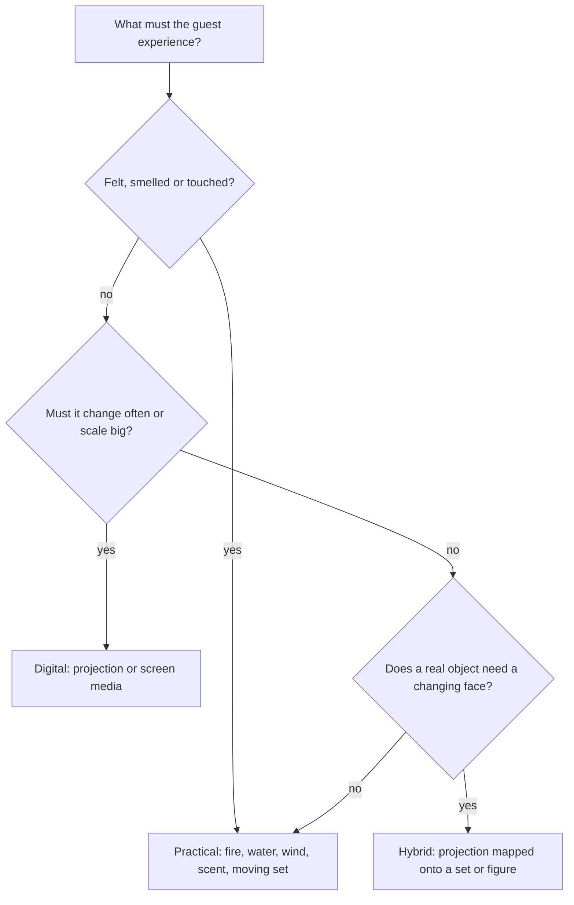

A practical effect is produced physically in front of the guest: real flame, real water, a real wall that moves. A digital effect is created in software and delivered as light. Practical effects often borrow from magic and only work from certain angles, so vehicle path and sightlines become part of the effect.

Practical wins on the senses. Heat on the face, mist on the arms and the smell of a scene are things no projector can send, and they feed the [multisensory](../human-factors/multisensory-integration.md) impression that makes a ride feel real. Vendors such as Technifex sell real fire, simulated fire, steam and water systems built for daily operation; their FauxFIRE line shows the hybrid middle ground, a safe physical effect that imitates a dangerous one.

Digital wins on change and risk. New media costs no steel and no permits, and it cannot burn anyone. The Hatbox Ghost is the lesson in combining them: a physical figure whose face is projected, so the body is real and the vanishing is pixels. Treat the choice as a [scope and value](../design-process/scope-and-value-engineering.md) decision with a [lifecycle](../operations-business/maintenance-and-lifecycle.md) cost attached, and as the hands-on sibling of the broader [screens versus sets](../show-technology/screens-vs-sets-debate.md) debate.

## Explore further
- `wikipedia-practical-effect` — Practical effect
- `technifex-effects` — Technifex: special effects and show systems
- `wikipedia-hatbox-ghost` — Hatbox Ghost
