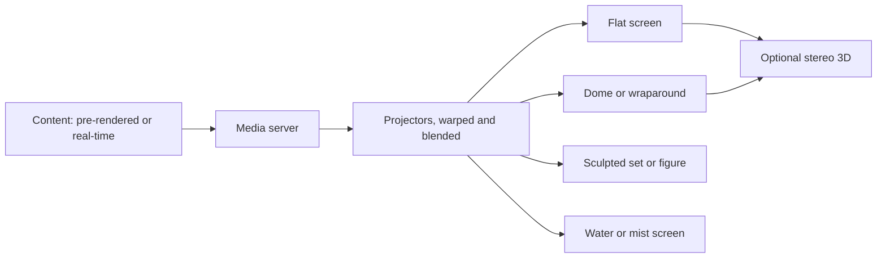

Projection is how a ride shows something that cannot be built: a city skyline, a flight over mountains, a ghost's face. The chain is simple to describe and hard to do well. A media server plays or renders frames, projectors throw them, and the image lands on a surface that may be flat, curved, three-dimensional or made of water.

Each surface has its own card. [Projection mapping](../show-technology/projection-mapping.md) fits video to sculpted sets and faces. [Domes](../show-technology/domes-and-wraparound-screens.md) fill peripheral vision for [flying theatres](../ride-systems/flying-theatre.md). [Stereoscopic 3D](../show-technology/stereoscopic-3d.md) adds depth, as on The Amazing Adventures of Spider-Man. [Blending](../show-technology/projector-blending.md) hides the seams between projectors. And the [screens versus sets](../show-technology/screens-vs-sets-debate.md) card weighs media against built scenery in a [media dark ride](../ride-systems/media-dark-ride.md).

Projection is rarely the whole show. The strongest attractions project onto, around and between physical [sets and props](../story-experience/set-dressing-and-props.md), so that the picture and the room agree. The rest of this land, from lighting to show control, exists to make that agreement hold every cycle.

## Explore further
- `wikipedia-projection-mapping` — Projection mapping
- `christie-digital` — Christie: projectors, dome solutions, warping and blending tools
- `wikipedia-amazing-adventures-of-spider-man` — The Amazing Adventures of Spider-Man
