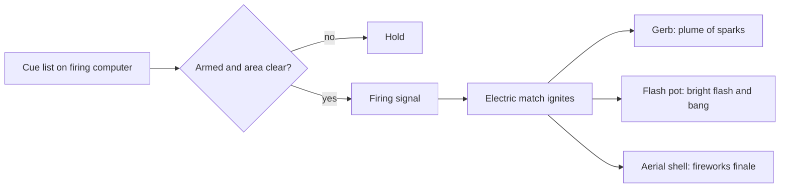

Pyrotechnics used inside a show, close to people, are called proximate pyrotechnics. The devices are small and specific. A gerb is a fountain that throws a controlled plume of sparks for a set burn time, and hung upside down in a row it becomes a waterfall. A flash pot gives a bright flash with a bang. Each is fired by an electric match on a remote signal from a firing system, either a manual console or a computer following a cue list in time with the show.

The rules are the point. In the United States NFPA 1126 is the standard for pyrotechnics before a proximate audience; most jurisdictions require special training and licensing beyond what outdoor fireworks demand. Commercial firing systems add safing circuits and keyed connectors so nothing fires while someone is near. Weather, especially wind, can cancel a cue or a whole show, which puts pyro inside the park's [weather policies](../safety-standards/weather-policies.md) and [entertainment schedule](../operations-business/entertainment-scheduling.md).

Display companies such as Pyro Spectaculars now run drone fleets as well, a sign of where [nighttime spectaculars](../show-technology/nighttime-spectaculars.md) are heading. On the ground, pyro still shapes [crowd planning](../masterplanning/parade-and-show-crowds.md): fallout zones, viewing areas and exits are set before the first shell is loaded.

## Explore further
- `wikipedia-pyrotechnics` — Pyrotechnics
- `nfpa-1126` — NFPA 1126: Pyrotechnics Before a Proximate Audience
- `pyro-spectaculars` — Pyro Spectaculars
