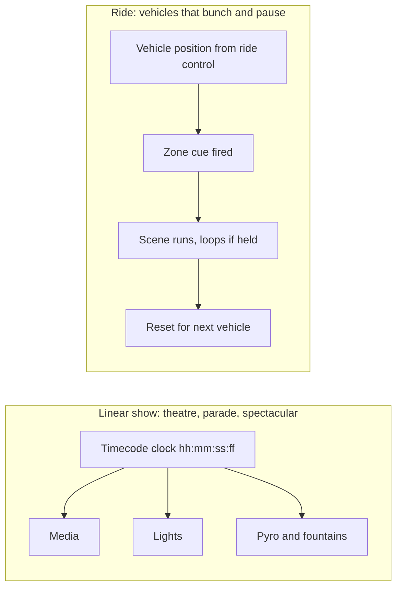

A theatre show, parade or fountain spectacular is linear: one performance, one clock. SMPTE timecode labels every frame as hours, minutes, seconds and frames, and every device chases it, so a fountain burst and a music hit land together. A ride is not linear. Vehicles dispatch at intervals, stack up and stop when the [block system](../ride-engineering/block-system.md) says so, so no single clock knows where the audience is.

Rides therefore sync to position. [Track sensors](../ride-engineering/sensors-and-switches.md) and the ride controller report which vehicle is where, and the show controller fires that scene's cues for that vehicle, then resets for the next. Each scene is built to tolerate a pause: media loops at a safe point, figures hold an idle pose, audio beds keep playing. On a [trackless ride](../ride-systems/trackless-ride.md) or an [enhanced motion vehicle](../ride-systems/enhanced-motion-vehicle.md), the vehicle's own program and the scene's program are written as a pair, so an on-board motion profile lines up with a projected clip.

Rock 'n' Roller Coaster instead syncs per train, tying each soundtrack to a specific train from launch. Done right, nothing is noticed; done wrong, a roar that lands two seconds late is a classic way of [breaking immersion](../human-factors/breaking-immersion.md).

## Explore further
- `wikipedia-smpte-timecode` — SMPTE timecode
- `alcorn-mcbride-show-control` — Alcorn McBride: show control, audio and video
- `huntington-show-networks-book` — Show Networks and Control Systems
