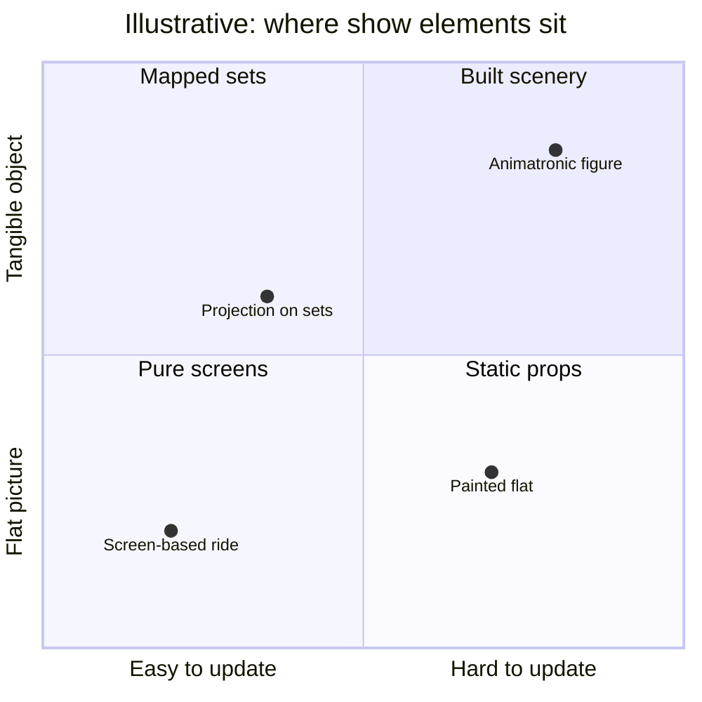

Every dark-ride brief eventually hits the same argument. Screens can show anything, at any scale, and the content can be re-cut for a new film or season without touching the building. Physical sets and figures occupy real space, cast real shadows, and still read correctly when a guest looks the "wrong" way. Fans tend to praise built scenery and complain about "screen rides"; producers notice that media scales with a budget and sets do not.

The useful framing is not either/or but what each is for. Media handles motion, scale and change; physical scenery handles presence, touchable detail and [suspension of disbelief](../human-factors/suspension-of-disbelief.md) when the vehicle pauses. Spider-Man, from 1999, already combined screens with built sets between them. Projection mapping onto sculpted sets, as on the Hatbox Ghost, is the hybrid that has quietly won: a physical object wearing a changeable face.

The decision is also a [scope and value](../design-process/scope-and-value-engineering.md) call made early, and it shapes later [retheming](../operations-business/retheming-and-overlays.md): a [media dark ride](../ride-systems/media-dark-ride.md) can be re-skinned with new footage, while a [classic dark ride](../ride-systems/classic-dark-ride.md) needs new props. The quadrant positions above are illustrative judgements, not measured data.

## Explore further
- `wikipedia-dark-ride` — Dark ride
- `wikipedia-amazing-adventures-of-spider-man` — The Amazing Adventures of Spider-Man
- `wikipedia-projection-mapping` — Projection mapping
