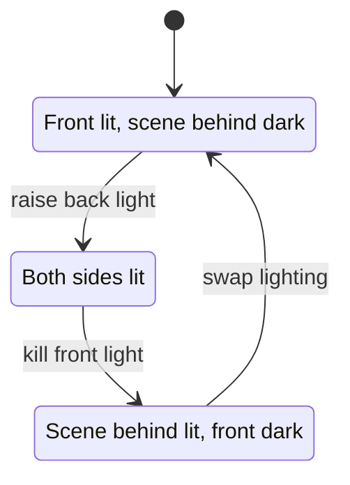

A scrim is a loosely woven fabric, often the "sharkstooth" weave named for its triangular holes. Its trick is entirely about light. Lit from the front with the space behind it dark, the threads catch the light and the cloth reads as a solid painted wall. Light the scene behind it instead and the threads disappear, leaving a soft window into the next space. Light both sides and you get a misty, dreamlike bleed-through.

Dark rides use scrims to make walls dissolve on cue: a bedroom wall becomes a forest, a portrait becomes a corridor. The change costs nothing mechanical, only a lighting cue on the show controller, which is why it is loved by [theatre staging](../story-experience/theatre-staging.md) and ride designers alike. It also depends on the guest's eyes being [dark-adapted](../human-factors/dark-adaptation.md); stray light on the front of the scrim ruins the transparency, the same enemy that defeated the original Hatbox Ghost.

Layered scrims can produce moiré patterns, so designers keep them apart or offset the weaves. Used well, a scrim is the cheapest [portal](../story-experience/thresholds-and-portals.md) in the toolkit and a core technique of [reveal and concealment](../story-experience/reveal-and-concealment.md).

## Explore further
- `wikipedia-scrim` — Scrim (material)
- `wikipedia-stage-lighting` — Stage lighting
