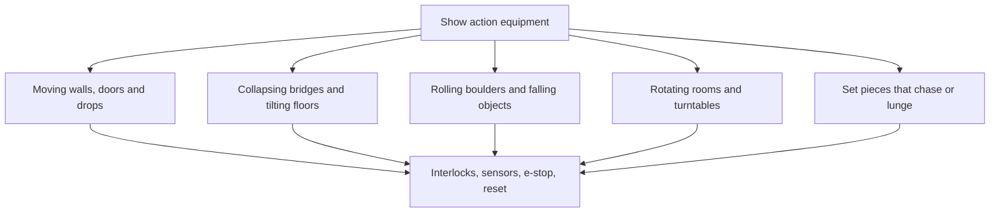

Show action equipment, SAE for short, is the industry's name for scenery that moves. It is neither vehicle nor figure: a wall that slides away, a bridge that drops under the vehicle, a doorway that closes behind guests, a boulder that rolls and resets for the next group. Indiana Jones Adventure's rolling boulder at Disneyland is the famous case. Vendors such as Falcon's Attractions list it alongside ride systems and animated figures as a category of its own.

Mechanically SAE is industrial automation in a costume: motors, hydraulics or pneumatics, sensors and a controller. The duty cycle and the audience make it theme-park work. A move that happens once on stage happens every forty seconds here, so it needs [preventive maintenance](../operations-business/preventive-maintenance.md) and a guaranteed reset. Because a guest's arm may be within reach, every piece is checked against the [reach envelope](../safety-standards/reach-envelope.md), fitted with interlocks, and tied to the ride's [emergency stop](../safety-standards/emergency-stop-and-evacuation.md) so a halted vehicle never sits under a moving object.

Integrators like Birket Engineering tie SAE into show control with figures, effects and media. The payoff is [kinetic scenes](../story-experience/kinetics-in-scenes.md) that feel dangerous yet are fully predictable. Which vendors built which named effects is not confirmed here.

## Explore further
- `birket-engineering` — Birket Engineering: ride and show control integration
- `falcons-attractions` — Falcon's Attractions: ride systems, show-action equipment and animated figures
